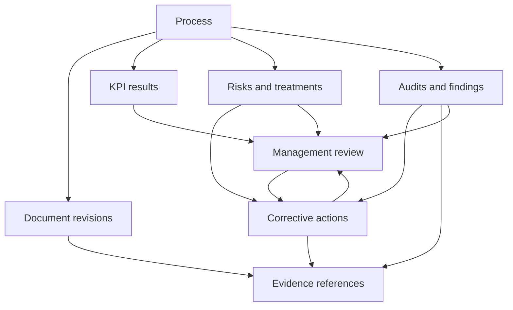

# ThryveMS consolidated backend plan, version 3.0

15 October 2026 · Product owner: Danica Marie Boton · Repository: https://github.com/dbauto/afdhlskdfs-iqms-preview

**Status: normative.** This single file replaces the consolidated plan v2.1, the architecture specification v1.3 and the backend plan v1.0. It contains every requirement that remains in force, with conflicts resolved and open choices decided. Nothing outside this file is a requirement unless this file points to it. The earlier documents are kept unchanged in `plan/reference/` for traceability only.

What changed from v2.1 (details in `plan/REVIEW_v2.1.md`):
- One normative text instead of a reconciliation plus two verbatim appendices.
- Vendors and defaults decided, with a cost model (§2–§3).
- Per-client topology redesigned around Cloudflare account limits (Hyperdrive 25 configurations, 500 Workers, 250 Cron Triggers).
- Front end aligned with the rules: links only, 1–4 hour support access, session limits, mandatory MFA for administrators, diagnostics off by default, no hidden counts, consultant classification limits, KPI "No data".
- Legal pack (Terms, Privacy Notice, DPA, Subprocessors, Security Overview, Service Levels, Acceptable Use, Cookies, AI Addendum) and operator policies POL-01 to POL-15 delivered and shown in the app.

## 1. How to use this plan
1. Read this whole file before writing code, then `AGENTS.md`.
2. Precedence: Danica’s written decisions → this file → the front end in `app/` as evidence of screens and wording. Where the front end contradicts this file, this file wins and the front end is a defect.
3. **Must** is required for launch. **Should** is expected unless a decision record in `plan/decisions/ADR-nnn.md` explains otherwise. Decisions in §2 are made; reopening one needs an ADR with Danica’s approval.
4. Do not deploy to production, change live client data or push to `main` without review. Work in branches and pull requests.
5. Keep `plan/progress.md` updated with what was done, tested and next.


## 2. Decisions
| # | Topic | Decision | Rejected and why |
|---|---|---|---|
| D1 | Client isolation | One Cloudflare Worker and one PostgreSQL database per client, one shared codebase, a separate platform control plane | Shared multi-tenant DB: cheaper at scale but a cross-client bug exposes everyone; clients in audited industries prefer separation |
| D2 | Database | **Neon PostgreSQL**, region `aws-ap-southeast-1` (Singapore). One Neon project per client. **Scale plan** for production (99.95% SLA, 30-day restore window, SOC 2, IP allow), **Launch plan** organisation for sandbox and staging | Supabase: PITR is USD 100/month per project and compute USD 10/project minimum, too expensive per client. PlanetScale Postgres: cheapest fixed node but no published Singapore region or restore window. AWS RDS: USD 18+ per instance per month, ops burden, no scale-to-zero |
| D3 | DB connection from Workers | **Neon serverless driver** (`@neondatabase/serverless`) `Pool` over WebSocket, created, used and closed inside each request or queue batch; Drizzle ORM on top | Hyperdrive allows only 25 configurations per account (paid), not enough for per-client databases. Use Hyperdrive only for the platform DB |
| D4 | Hosting of the UI | The client Worker serves the built React app as **Workers static assets**. UI and API share one origin per client (`https://<client>.iqms.ph` or the client’s custom domain) | Separate Pages project: second origin, CORS, more config per client |
| D5 | API framework | Hono + zod + `@hono/zod-openapi`, prefix **`/api/v1`**, OpenAPI at `/api/v1/openapi.json` | — |
| D6 | Background work | One **Cloudflare Queue per client** consumed by the same client Worker. **No per-client Cron Triggers**: the platform `scheduler` Worker runs crons and enqueues signed, bounded commands to each client queue | Per-client crons hit the 250-per-account limit |
| D7 | Microsoft sign-in | **Direct OpenID Connect with Microsoft Entra ID**, one multi-tenant app registration per environment, per-client tenant allow-list, redirect URI registered per client host by the provisioning runbook | Brokers hide `tid`/`oid` claims that we need for tenant checks |
| D8 | Email, password, MFA, passkeys | **WorkOS AuthKit** for people without Microsoft accounts (consultants, outside auditors, guests). Free up to 1M monthly active users. Data stored in the United States (WorkOS DPA, Exhibit B): disclosed as a cross-border transfer | Building password, MFA and recovery ourselves; Supabase Auth (would add a Supabase project per client) |
| D9 | Platform console access | Cloudflare **Access** (Zero Trust, free up to 50 users) in front of the platform hostname, plus WorkOS sign-in with passkey for platform admins | App sign-in alone |
| D10 | Outbound email | **Amazon SES**, region `ap-southeast-1`, dedicated sending domain with SPF, DKIM, DMARC `p=quarantine`. Emails never carry confidential titles | Resend/Postmark: fine, but US-only processing and higher price |
| D11 | Inbound support email | Cloudflare Email Routing → Email Worker on `support@iqms.ph`, text only, attachments dropped | Reading a personal inbox (prompt-injection and privacy risk) |
| D12 | Files | **Links only** for controlled documents, evidence, signed records, notes, certificates and support. One exception: **logo images** (PNG, JPEG, WebP ≤ 500 KB), re-encoded to PNG through the Cloudflare Images binding, stored in R2 | General uploads: storage, malware scanning, retention and breach surface |
| D13 | Temporary exports | R2 bucket `iqms-exports-<env>`, objects expire after 24 hours, downloaded through an authenticated Worker route (not bare presigned URLs) | — |
| D14 | Backups and audit checkpoints | Neon point-in-time restore (30 days on Scale) **plus** nightly encrypted logical dumps and daily audit-log checkpoints to **AWS S3 `ap-southeast-1` with Object Lock (compliance mode)** in a separate AWS account | R2: location is best effort and no compliance-mode lock |
| D15 | Session policy | Idle timeout set by the client: 15, 30 (default) or 60 minutes. Absolute limit 8 hours (default) or 12 hours. Re-authentication within 10 minutes for owner transfer, role changes, exports and support grants | 7-day sessions |
| D16 | MFA | Always required for client Owners, Administrators, Quality managers and platform admins. Client chooses for other roles. Microsoft users: enforced through the client’s Entra Conditional Access; ThryveMS checks the `amr` claim for privileged roles and falls back to a WorkOS TOTP step-up when it’s absent | Optional for administrators |
| D17 | Support access | Granted by a client Owner or Administrator for 1, 2 or 4 hours, renewable, read-only, tied to a support report number, excludes Confidential and Highly confidential records, revocable at once | 24 or 72 hours |
| D18 | Consultant access | The platform sends an **assignment request**; the client Owner or Administrator approves it in Users and access, which creates the local consultant membership. Consultants: Public and Internal records; Confidential only when named; **Highly confidential never**; never approvers, never top management. Clients see "Your consultant" instead of the name in remarks and review notes; the real identity stays in the activity log and in Users and access | Platform-only assignment |
| D19 | Service targets (contractual) | Availability 99.5% monthly, RPO 24 hours, RTO 8 hours. Internal targets: RPO 1 hour (PITR), RTO 4 hours. Revisit after two quarters of measurements | 99.9%/15-minute RPO before any measurement |
| D20 | AI | Off by default. The maintenance agent sees code, sanitised reports and synthetic data only; never client records; deploys need Danica’s approval. Client-facing AI is out of scope for release 1 | — |
| D21 | Payments | Out of scope for release 1. Billing page shows plan, seats and invoices sent by email | — |
| D22 | Process access | People are assigned to processes (`process_memberships`). Roles scoped to "Processes they own" or "Processes they are assigned to" see only those processes, and the records of those processes are hidden from them too. Roles scoped to all processes (and auditors, "Not their own process") see every process. Processes have no visible number; they are shown by name | Lock individual processes to named people |

Region note for the Privacy Notice: client QMS data lives in Singapore (Neon on AWS, S3). Cloudflare processes requests at its edge (nearest data centre, usually Manila or Singapore). WorkOS sign-in data for non-Microsoft users is in the United States. Short-lived exports and logos in R2 have an Asia-Pacific location hint, not a guarantee.


## 3. Cost model
| Item | Fixed | Per client (20–50 users) | Notes |
|---|---|---|---|
| Cloudflare Workers Paid | 5 | ~0–1 | Requests and queue operations mostly within included amounts |
| Cloudflare zone Pro (WAF managed rules, rate limiting rules) | 25 | — | One zone `iqms.ph`; client subdomains included. Custom client domains via Cloudflare for SaaS: first 100 hostnames free |
| Cloudflare Access, Turnstile, Email Routing | 0 | — | Free tiers |
| R2 (exports, logos) | <1 | <0.1 | USD 0.015/GB-month, no egress fees |
| Neon Scale (production) | — | ~10–14 | 0.25–0.5 CU autoscaling, suspend after 15 min idle: about 200 active hours ≈ 50 CU-hours × USD 0.222 + 2 GB × (0.35 + 0.20 restore history) |
| Neon Launch (sandbox, staging, platform DB) | ~10 | — | USD 0.106/CU-hour, scale to zero |
| Amazon SES | ~1 | <0.5 | USD 0.10 per 1,000 emails |
| AWS S3 Object Lock backups | ~2 | ~0.5 | Standard-IA, 35-day lock on dumps, 7-year lock on audit checkpoints (compressed) |
| WorkOS AuthKit | 0 | 0 | Under 1M monthly active users; custom auth domain USD 99 optional |
| Microsoft Entra app registration | 0 | 0 | |
| GitHub Team | 4 per seat | — | Branch protection and environments |
| **Total** | **~USD 50** | **~USD 12–16** | 10 clients ≈ USD 200/month |

Cold start: a suspended Neon compute wakes in under a second; the first request after 15 minutes idle is slower. Clients who want no cold starts get an always-on minimum (≈ USD 40/month at 0.25 CU).


## 4. Product goals and boundaries
Build a configurable ISO 9001 QMS workspace with a standard core and purchased/custom modules. Each client has its own deployment, database, hostname and configuration. One codebase supports all clients; avoid separate repository forks for ordinary customization.

The app manages records, relationships, assignments, review decisions and evidence references. Actual controlled document/evidence files remain in the client's SharePoint/OneDrive or approved document platform. No file-upload endpoint is part of the initial client product. Generated export packages are a separate, temporary output function.

Platform administration and client administration are separate authorities. A developer does not automatically become a client approver. Client Owner is the maximum organization administration role, constrained by confidentiality rules, workflow assignments and separation-of-duty policy.

No ISO certification guarantee, universal legal-signature guarantee, AI decision engine, payment processor, arbitrary scripting engine or enterprise analytics warehouse is included in the first release.

Current scope: Overview, Search, Notifications, Organization & Scope, Policies, Processes, Objectives & KPIs, Documents (Register, Reviews), Risks & Opportunities, Evidence, Audits (programme, auditors, templates, checklists), Management Review (list, detail, record), Corrective Action (nonconformities, improvements, customer complaints), Consultant remarks and Certification readiness, Settings (including Legal and agreements and Contact support), Platform console (organisations, requests, logs, jobs, support reports, support access, team) and the public legal pages. Surveys, PDCA boards and payments are not part of release 1.


## 5. Current front-end baseline and known gaps
Preview: https://dbauto.github.io/afdhlskdfs-iqms-preview/ · Record the full commit SHA you start from in `plan/progress.md`.

Key source files: `app/src/App.tsx` (routes), `app/src/data/types.ts` (record shapes), `app/src/lib/store.tsx` (in-memory store, simulated identity and access levels), `app/src/lib/review-figures.ts` (management review figures), `app/src/legal/` (legal documents), `app/src/pages/**` (screens).

The prototype has no real identity, persistence or backend authorisation. Names serve as relationships; numbers are generated in the browser; dates, health flags and some figures are illustrative. Production must remove the fallback to the first sample user (unknown or inactive identities get no access) and must not seed demo client records.

Known front-end gaps to fix during integration (not requirements to copy):
| Gap | Fix |
|---|---|
| KPI results are a six-value array; the "Add result" dialog has no period | Period records and result-specific evidence (§17) with a period label in the dialog |
| Platform assigns consultants directly | Assignment request approved by the client (§10) |
| Evidence age uses a fixed 12 months | Client setting in QMS rules (§16) |
| Retention screen shows fixed periods | Shown as suggestions until the client saves its own (§28) |
| Billing page implies payments | Plan, seats and emailed invoices only in release 1 |
| Sample audit IA-2026-06 shows answers while its checklist editor shows none | Sample data only; real checklists are copied from template versions (§19) |
| Intermittent "u is not a function" render error on the GitHub Pages preview | Investigate in Phase 0; the error boundary records it for Contact support |


## 6. Topology and Cloudflare resources
```
iqms.ph zone (WAF, rate limits, Turnstile)
├── platform.iqms.ph ── Cloudflare Access ── Worker "platform" (UI + /papi/v1) ── Hyperdrive ── Neon "platform" (Singapore)
│                                              └── Cron Triggers → enqueue signed commands per client
├── <client>.iqms.ph ── Worker "client-<id>" (static UI + /api/v1 + queue consumer) ── Neon serverless driver ── Neon project "client-<id>"
│                         ├── Queue "q-<id>" (outbox dispatch, notifications, exports, reminders)
│                         ├── R2 iqms-exports (prefix <id>/), R2 iqms-brand (prefix <id>/)
│                         └── Images binding (logo re-encode)
├── support@iqms.ph ── Email Routing ── Worker "inbound-mail" → platform DB (minimal) → client queue (body)
└── Logs: Workers Logs (7 days) + Logpush to S3 (90 days, redacted)
```

Per client: 1 Worker, 1 Queue, 1 Neon project, 1 entry in the deployment manifest. Platform: 3 Workers (`platform`, `scheduler`, `inbound-mail`). Account limits allow about 450 clients; plan Workers for Platforms when passing 300.

**Deployment manifest** (`infra/clients/<id>.json`, validated by `infra/manifest.schema.json`): client id, hostname(s), environment, code version, Neon project and role (secret reference only), queue name, Entra tenant allow-list, enabled modules, branding version, release channel. The Worker reads its client id from a build-time binding; any request whose host, path or token names another client is rejected with 404.

Use a modular monolith with portable domain logic. A client API Worker and queue/cron entrypoints can share packages; deploy separate services only for a real boundary. Platform API/UI/database are distinct from client business APIs. Keep inbound support email and AI runner optional.

The client Worker selects its database using a trusted immutable deployment binding. If an orgId appears in an API path, it must match the deployment; it never selects a database. Every client table still carries organization_id. Reject host/environment/organization mismatches. Separate deployments do not imply dedicated hardware or separate provider outage domains.

Cross-client consultants authenticate at the selected client deployment and receive a local authorized session. A platform selector may show approved workspace addresses and minimum metadata, not aggregate QMS content. Do not share browser cookies across client hosts. Final identity topology must establish how one provider principal maps to independently approved local memberships.

Client jobs use local DB bindings and roles. Platform scheduling distributes bounded commands to clients; no universal production BYPASSRLS job role. Migrations and emergency infrastructure access remain separate audited paths.

Client databases are reached through the Neon serverless driver (decision D3); the platform database through Hyperdrive with query caching disabled for business, authorisation and configuration reads. Prove transaction behaviour and context cleanup under pooling in Phase 0. RLS includes USING and WITH CHECK as applicable; absent context fails closed. Runtime role is neither table owner nor BYPASSRLS. Test insert, update, delete and indirect links, not reads alone.

Same-origin client UI and API (decision D4). API prefix `/api/v1` and generate OpenAPI/client artifacts. Platform has an independent API origin and issuer/audience policy. Browser origin checks supplement identity; they do not prove that a caller used the platform console.

Request and isolation rules:
- The client Worker reads its client id from a build-time binding. Any request whose host, path or token names another client is rejected with 404.
- Platform scheduling distributes bounded, signed commands (audience, client id, command id, expiry, replay protection) to client queues. There is no production role that bypasses row-level security across clients.
- Client APIs keep working during a platform console outage, except provisioning and billing changes.


## 7. Ownership and data locations
| Store | Owns | Must not contain | Location |
|---|---|---|---|
| Client database (Neon project per client) | Memberships, roles, QMS records, revisions, decisions, tasks, evidence links, privacy operations, full support reports, agreement acceptances | Passwords, raw integration secrets | Singapore |
| Platform database (Neon) | Client registry, plans, deployment manifests, health summaries, minimal support report index, platform identities, legal document versions | QMS content | Singapore |
| Microsoft Entra ID (client’s tenant) | Staff credentials and MFA | Authorisation decisions | Client’s Microsoft geography |
| WorkOS | Credentials, MFA and passkeys for non-Microsoft users | Authorisation decisions | United States |
| Worker secrets | Database roles, API keys, signing keys | Browser-readable settings | Cloudflare |
| Client SharePoint or OneDrive | Controlled documents, evidence files, signed records | ThryveMS permissions as a substitute for Microsoft access | Client’s Microsoft geography |
| R2 `iqms-exports` | Exports for at most 24 hours | Uploaded documents | Asia-Pacific hint (best effort) |
| R2 `iqms-brand` | Re-encoded logos | Confidential images | Asia-Pacific hint (best effort) |
| S3 Object Lock (separate AWS account) | Encrypted nightly dumps (35 days), audit checkpoints (7 years) | Unencrypted data | Singapore |
| Amazon SES | Outbound notification emails in transit | Confidential record titles | Singapore |

Names, emails, titles, comments, findings, links and logs can contain personal data; all stores above are in the processing register (POL-02) and the Subprocessors page.


## 8. Identity, sessions and authentication
- Microsoft: authorization code + PKCE + state + nonce. Validate `iss`, `aud`, signature, `exp`, `nbf`, and `tid` against the client allow-list. Identify a person by (`iss`, `tid`, `oid`). Personal Microsoft accounts are rejected unless the client enables them.
- WorkOS: hosted AuthKit, code exchange server-side, identify by WorkOS user id. MFA (TOTP) and passkeys enabled.
- **Sign-in never creates access**: the person needs an accepted invitation or approved access request and an active membership in this client database.
- **Account linking**: never by matching email. Linking a Microsoft identity and a WorkOS identity needs both sign-ins in one flow.
- Session: random 256-bit token in cookie `__Host-iqms_session` (Secure, HttpOnly, SameSite=Lax, Path=/, no Domain). Database stores SHA-256 of the token, membership, assurance level, created, last seen, idle and absolute expiry, authorisation epoch. Rotate on sign-in and on privilege change.
- CSRF: synchroniser token in `X-CSRF-Token` for every non-GET; Origin header must equal the client host.
- Deactivation, role change or support-grant revocation increments the membership’s authorisation epoch; sessions with an older epoch are refused on the next request.
- Consultant switching clients: the user menu lists approved workspaces from the platform (hostnames only). Opening one redirects to that host’s sign-in, which completes silently when the IdP session is still valid.

Topology (decided): direct Entra OIDC for Microsoft users plus WorkOS AuthKit for email, guest and consultant users, normalised by one backend identity adapter with two explicit issuer-validation paths.

Platform staff sign in through WorkOS with passkeys behind Cloudflare Access (decision D9); no local passwords.

OIDC flow uses authorization code, PKCE, state and nonce with approved exact callback URLs. Validate issuer, audience, signature, expiry and tenant claims as applicable. Identify people by stable issuer/subject; for Entra keep tenant/object identifiers where available. Never merge identities automatically solely because emails match. Account linking requires verified proof of both identities or a controlled recovery procedure.

Microsoft sign-in does not grant membership. Invited identity must match invitation rules, configured tenant policy and active local membership. Personal Microsoft accounts and cross-tenant guests are blocked unless specifically enabled for that client. The multi-tenant app registration is not an access policy; the per-client tenant allow-list is.

Browser receives an opaque random session token in a __Host- prefixed Secure, HttpOnly, Path=/ cookie without Domain. Store only the token hash, principal, organization, assurance state, expiry, revocation and authorization epoch in the session store. SameSite=Lax is proposed; test redirects and CSRF controls. Rotate on login and privilege changes. Keep provider tokens server-side when needed; encrypt retained refresh tokens with separately managed keys. Do not store bearer tokens in localStorage.

Require CSRF protection and Origin verification for cookie-authenticated mutations. CORS allows only configured origins. Logout revokes the app session; describe separately whether upstream Microsoft sign-out occurs. Password reset, verified email and MFA for non-Microsoft users are managed by WorkOS; ThryveMS adds its own rate limits. Privileged app actions require verified assurance, not merely a visible MFA setting.

Session limits and step-up follow decisions D15–D16. Validate Entra assurance signals (`amr`) rather than assuming an ordinary ID token proves MFA.


## 9. Authorisation and role model
The rules below apply together with the role model that follows in this section (explicit permissions, multiple roles, scopes, grant ceilings, last-owner protection):

- The role editor’s None/View/Add and edit/Approve/Manage per area maps to permission sets in `packages/authorization/templates.ts`. "Approve" grants decision rights on assigned workflow steps only; it never implies edit, publish or share.
- Classification:
  - **Public**: everyone in the workspace (not the internet).
  - **Internal**: members with View on the area.
  - **Confidential**: named viewers, the owner, route members, and roles granted `classification.confidential.read`.
  - **Highly confidential**: named viewers and the owner only. Sharing needs the owner’s approval. Hidden during support access. Never consultants.
- Lists, search, counts, figures, notifications, review snapshots and exports filter before counting. **No "N hidden items" messages.**
- Process scope (decision D22): a person whose role is scoped to "Processes they own" or "Processes they are assigned to" sees a process only when they own it or are listed in its `process_memberships`. Records follow their process: documents and revisions, risks and opportunities, objectives and results, audits, nonconformities and their actions, and remarks on any of these are invisible when their process is out of scope, including in search, counts, notifications and exports, and direct links answer "not found". Evidence is visible when at least one of its process links is in scope, then its own classification and per-link checks apply. Records with no process are company-wide. Process scope only narrows access; it never widens classification access. Changing memberships needs Manage on Processes, is logged, and removing someone increments their authorisation epoch so it takes effect on the next request. New record numbers are assigned by the server, so a person can't infer hidden records from gaps they can see.
- Separation of duties enforced on the server: authors and revisers can’t approve their revision; NC owners can’t verify their own action; auditors can’t audit processes they own or work in unless an authorised override with a reason is recorded; consultants can’t approve or sign off.
- Masking: one serializer (`packages/domain/people/display.ts`) returns `{ display: "Your consultant", isConsultant: true }` for consultant actors when the viewer isn’t a consultant. Activity log and Users and access show the real identity to Owners and Administrators.

Authorization is: active membership AND action permission AND entitled module AND permitted scope AND classification access AND valid workflow state/assignment AND no policy conflict. Deny by default. Evaluate on every request, including search, counts, activity feeds, exports, link resolution, background processing and support access.

Use individual permissions, such as document.read, document.create, document.edit_draft, document.submit, document.review, document.approve, document.publish, document.archive, audit.plan, audit.answer, audit.issue_report, corrective_action.verify, user.manage, role.manage, data.export and support.grant. Approval does not imply editing or publication.

Membership can have multiple roles. Role grants include scope: organization, department, location, assigned process or assigned record. A role definition must not imply a staff name relationship. Use membership IDs for business assignments. Templates: Client Owner, Client Administrator, Quality Manager, Process Owner, Contributor, Reviewer/Approver, Auditor, Viewer and Guest Auditor.

| Role/authority | Allowed baseline | Additional restriction |
|---|---|---|
| Platform staff | Provisioning, deployments, health, support requests | No routine client content access or business approval |
| Client Owner | Whole-organization administration and ownership | Confidential records and approvals follow explicit policy |
| Client Administrator | Staff and workspace configuration | Cannot create platform privileges or exceed grant ceiling |
| Quality Manager | QMS coordination and authorized reporting | Required workflow assignments still apply |
| Process Owner | Owned/assigned processes | Other process data requires another grant |
| Reviewer/Approver | Assigned steps | Exact revision and active assignment required |
| Auditor | Assigned audits/evidence | Independence policy can prohibit own-process audit |
| Guest Auditor | Explicit records/scopes until expiry | No general organization browsing by default |

Public classification means least restricted inside the workspace; it does not mean anonymous internet publication. Confidential and Highly confidential use explicit access policy/grants. Owners do not get Confidential or Highly confidential access from their role alone: Confidential needs a named grant or `classification.confidential.read`; Highly confidential needs to be named. Sharing may grant permitted record reading within policy, not promote role, bypass classification or grant SharePoint access.

Administration follows grant ceilings: cannot assign permissions outside authorized administrative capability; protect last active Owner; owner transfer is atomic and step-up protected. Record client-approved emergency recovery procedures. User deactivation increments authorization epoch, revokes sessions and creates reassignment tasks while preserving historical attribution.

The visible None/View/Add and edit/Approve/Manage controls can remain a role-editor abstraction. Backend translates reviewed templates into explicit permissions. Approve must not automatically imply edit, publish, delete or grant access. Every command evaluates membership + action + entitlement + scope + classification + workflow assignment/state + independence.

Platform consultant assignment is an assignment request that the client Owner or Administrator approves (decision D18). Client API owns membership activation/revocation. Deactivation stops access, notifications and downloads without destroying attribution.

Consultant classification access is decided: Public and Internal; Confidential only with an explicit local grant; Highly confidential never. If identity display is masked, retain real attribution in protected audit records and define every audience explicitly. Masking is display policy, not security/anonymity.

Support grants identify real platform principal, purpose/ticket, actions, record/process scope, classification ceiling, time window and revocation. Default read-only; no business approvals, privilege changes or bulk exports. Grants last 1, 2 or 4 hours and are renewable; the client can revoke immediately (decision D17). Cloud infrastructure privileges must be documented separately because app support restrictions cannot eliminate provider-admin access.

Auditor independence checks use explicit assignments and involvement IDs, not string inclusion/name matching. Override needs permission, reason, authorized approval and history; a text box alone does not establish objective/impartial audit suitability. NC verification defaults to someone independent of the action owner.


## 10. Platform and client administration
Platform database logical tables: clients, client_domains, deployments, releases, entitlements, provisioning_requests, platform_principals, platform_roles, support_requests, operational_commands, health_reports, billing_references, platform_events and migration_runs.

Client DB is authoritative for effective support grants. Grant fields: ID, platform principal, client approver, ticket/purpose, allowed actions, record/process scope, classification ceiling, start/end, revocation and constraints. Every support request checks it locally. Use the developer's real identity with support context; do not silently impersonate staff. Log support session creation, resource access and operations. Default support is read-only, denies confidential records and denies business approvals. Export requires a separate explicit grant.

Support grants last 1, 2 or 4 hours with renewal by the client. Revocation blocks subsequent requests immediately. A platform-side record alone cannot extend an expired client grant. A platform health page receives sanitized codes and counts, not detailed confidential failures or raw SQL payloads.

Consultant assignment flow: platform admin creates an assignment request (consultant identity, client, purpose, end date) → client Owner or Administrator sees it in Users and access and approves or declines → approval creates the local consultant membership with the Consultant role → the consultant’s workspace switcher shows the client host. Ending the assignment (either side) deactivates the membership, revokes sessions for that client and stops notifications, keeping attribution.


## 11. Database conventions and integrity
Use stable UUID primary keys; versioned human codes are separate strings. Tenant business tables carry organization_id even in a single-client database. Enforce that the DB belongs to its configured organization. Use composite foreign keys or equivalent constraints to prevent mismatched organization references. All timestamps use UTC timestamptz; use date for date-only deadlines and an IANA timezone for scheduling. Audit years/reporting periods follow organization settings.

Foreign keys, unique constraints and CHECK constraints enforce invariants. Prefer restrict-on-delete for historical business relationships. Tombstones are not a retention strategy by themselves. Monetary values and quantitative measurements use decimal/numeric rather than floating-point when exactness matters. JSONB supports structured answer payloads and snapshots; core identities, relationships and searchable fields remain typed columns.

Common mutable fields: id, organization_id, created_at, created_by, updated_at, updated_by, row_version. Add status, classification, retention_category_id where appropriate. Actor references account for system jobs and support actors; do not require fictitious human users.

DB runtime role MUST NOT be superuser, schema owner or BYPASSRLS. Migration role is separate. Use PostgreSQL RLS where it provides defense in depth, with transaction-scoped organization/principal context and tested pool reset behavior. Fail if context is missing. RLS is not a replacement for application action/workflow authorization. A table with RLS enabled but a bypassing service key is not isolated.

Important indexes: organization/status/due dates; process relations; record code uniqueness; revision document/number uniqueness; active workflow lookup; session hash; outbox pending/next_attempt; notification deduplication; measurement objective/period; search vectors. Indexes should follow measured query patterns.

Use the prototype types in `app/src/data/types.ts` as the field inventory. Additional conventions:

UUID v7 keys; human codes from per-client counters; `organization_id` on every business table with a `CHECK (organization_id = deployment_org())` where `deployment_org()` reads a one-row `deployment` table set at provisioning; RLS policies keyed on the session context as defence in depth; runtime role is not owner and has no BYPASSRLS; migrations run as a separate role. Status codes are machine values (`technical_review`) with UI labels kept in the front end.


## 12. Entity catalogue
The implementer must expand this into final DDL with field types, cardinalities, indexes, constraints and deletion behavior.

| Domain | Tables/entities and minimum information |
|---|---|
| Identity | principals; external_identities (issuer, subject, tenant); memberships (status, expiry); sessions; invitations; access_requests |
| Authorization | roles; permissions; membership_roles; role_permissions; scope_assignments; record_grants; authorization_epoch |
| Organization | organizations; departments; locations; scope_versions; context_issues; interested_parties; interested_party_reviews |
| Processes | processes; process_versions; process_memberships; process_connections (source/target/type); process_clause_links |
| Standards | standards (edition); clauses (parent/code); typed record_clause mappings |
| Policies | policies; policy_revisions; policy_acknowledgements; audience_assignments |
| Documents | documents; document_revisions; external_references; revision_reference_links; document_shares; revision_comments |
| Workflow | workflow_definitions; workflow_definition_versions; workflow_instances; workflow_steps; step_assignments; workflow_decisions; transitions |
| Objectives | objectives; measure_definition_versions; objective_target_versions; measurement_periods; measurement_results; result_corrections |
| Risks | risks_opportunities; risk_assessments; treatment_plans; risk_reviews; linked_actions |
| Evidence | evidence_items; evidence_reference_versions; typed record_evidence links; evidence_clause_links |
| Audits | audit_programmes; audits; audit_processes; auditor_assignments; checklist_templates; template_versions; audit_checklists (audit, stable form identity, Checklist/Questionnaire kind, version, Draft/Released/Revised, questionnaire mode, release actor/time, revision reason); sections; questions (response routing, evidence rule, choices, N/A justification, conditional visibility); questionnaire_assignments; questionnaire_invitations (restricted respondent, assignment, expiry/revocation and verified identity binding); auditee_responses, draft history and immutable submission snapshots; auditor_assessments (with the corrective-action link for nonconformity results); evidence_verifications; clarification_requests; audit_report_versions (with findings-paper links) |
| Improvement | nonconformities; containment_records; root_cause_versions; action_tasks; task_assignees; verifications; effectiveness_reviews; closure_decisions |
| Management review | management_reviews; attendees; agenda_items; review_inputs; input_snapshots; decisions; linked_tasks |
| Operations | outbox_events; jobs; job_attempts; processed_messages; notifications; delivery_attempts; idempotency_records; numbering_counters |
| Settings | configuration_versions; numbering_rules; retention_rules; notification_preferences; integration_connections; entitlements |
| Privacy and audit | business_events; access_events; support_grants; data_subject_requests; legal_holds; deletion_jobs; export_jobs; incident_records; evidence_register |

Prefer typed join tables with real foreign keys for cross-module relationships. If using a generic entity registry, design enforced target existence and tenant integrity; a free-text entity_type/entity_id pair is insufficient integrity by itself.

Cardinalities: organization has many memberships/processes; principal has multiple external identities; membership has multiple roles/scopes; process has multiple owners/assignments with designated accountable owner; document has many revisions; revision has workflow instances across resubmission cycles; instance has ordered steps; step has assignments and decisions; audit has multiple processes/clauses/auditors/findings; objective has many period results; evidence has many authorized record links.

Corrections and additions that are part of the catalogue:

Use UUIDs for durable identity and separate unique human codes. Processes have no human code: they are shown by name, and their UUID is used in links. References use membership/actor IDs rather than staff names. Preserve stable machine status codes separately from UI labels. Use UTC timestamps, local date deadlines and configured IANA timezones. Use numeric for final KPI values. Enforce organization-consistent foreign keys and restrict deletion of historical relationships.

Model these explicitly:

| Domain | Required correction |
|---|---|
| Identity | Issuer/subject uniqueness, token-hash sessions, assurance/epoch/revocation, verified account linking; no email-only identity merge |
| Access | Multiple roles/scopes, record grants, permission ceilings, last-owner protection and classification policy |
| Structure | Versioned scope/process configuration, typed process relationships, normalized clause edition/mappings |
| Policies | Policy revisions and revision-specific audience acknowledgements |
| Documents | Revision-specific external references, definition versions, workflow instances/cycles, steps, assignments and immutable decisions |
| Audit | Template versions, copied audit checklist/questions, typed answers/edit history, report versions, contributors and amendments |
| NC | Verification/effectiveness/closure/reopening records; task helpers and risk assessment/check history |
| Review | Meeting occurrences for Several meetings, input coverage links, frozen source versions, pack versions, sign-off history and amendments |
| Evidence | Versioned references, typed record joins, restricted access inheritance and result-specific joins |
| Operations | Transactional outbox, deduplication, idempotency, attempts, delivery state, legal holds and deletion/export jobs |
| Customization | Versioned settings/branding, custom field definitions, module compatibility and deployment/release manifests |
| Support | Local support grants, scoped events, minimal platform reports, separately protected attachments if later approved |

Replace reviewer/approver UUID arrays with relational assignments. Generic target_type/target_id links require an enforced entity registry or typed foreign-key joins; arbitrary identifiers are insufficient. An email can be a contact attribute, not proof that two identities are the same person.

### Cross-record links
- Evidence: `evidence_links` with one nullable foreign key per target type (`document_revision_id`, `nonconformity_id`, `management_review_id`, `objective_result_id`, `audit_report_version_id`, `risk_id`) and a `CHECK` that exactly one is set.
- Comments and remarks: `record_refs (id, kind, document_id, process_id, risk_id, audit_id, evidence_id, nonconformity_id, management_review_id)` with the same exactly-one check; comments and remarks reference `record_ref_id`.

### Management review
`management_reviews` (format, date, reporting period `period_start`/`period_end`, preparer, stage, `locked_at`), `review_participants` (top management, other or contributor; status: not opened, opened, commented, signed off, present, apologies), `review_inputs` (ref; analysis in four fields: `summary`, `observations`, `attention`, `recommendations`; `prepared_by`, `updated_at`, `draft`, `confirmed_by`, `handed_to`, not_applicable reason), `review_sessions` (for "Several meetings": date, title), `review_input_coverage` (input → session), `review_comments`, `review_record_checks` (one row per supporting record someone acted on, or per manual reference: input ref, `record_ref_id` or an https URL with title, added_by, status Not reviewed / Reviewed / Needs clarification / Insufficient evidence, by, at, notes, evidence reference), `review_evaluations` (input ref or `overall`, author, optional status Satisfactory / Needs improvement / Requires management action, comment, clarification question, answer, answered by and at), `review_proposed_decisions` (text, type, input ref, source `record_ref_id`s, evaluation, proposed by), `review_snapshots` (kind `pack` or `final`; per input: value, detail, status `valid`/`zero`/`not-collected`/`no-source`, period, calculation method, computed_at; with `review_snapshot_sources` listing each source `record_ref_id`, its version or `updated_at`, title, status and date, and the record check status at lock), `review_signoffs` (append-only ledger: method in-app or linked signed record, actor, time), `review_actions` (type, owner, due, state, linked record, input ref, source `record_ref_id`s, evaluation, completion evidence links, reminders sent), `review_amendments` (append-only: change, reason, actor, time). "Opened" means the person opened the pack, not that they read or accepted it. Record checks and evaluations are workflow controls, not ISO conformity decisions. All of these carry `organization_id` and follow the isolation suite.

### Legal and consent
Platform DB: `legal_documents (id, code, version, title, effective_date, body_hash, published_at)`.
Client DB: `agreement_acceptances (id, organization_id, document_code, version, accepted_by_membership, role, accepted_at, ip_hash, user_agent)` and `policy_notice_views` for the Privacy Notice shown at first sign-in. New versions require fresh acceptance by an Owner before the effective date; the app shows a banner to Owners until accepted.

### Support and error reports
Platform DB keeps `support_reports_min (number, client_id, source, category, impact, state, created_at, platform_assignee)`. The client DB keeps the full report (`support_reports`, `support_report_updates`, `diagnostic_bundles` with payload hash and consent record). Platform staff read the body only under an active support grant or when the reporter chose "Share with the ThryveMS team" on submit (default on for reports from people, since they’re writing to us; diagnostics separately opt-in).

### Other tables already in the front end
Notifications and preferences, remarks and replies, readiness requirements and certification dates, auditors with exclusions, evidence links ("Used on"), nonconformity–risk links (clause 10.2.1 e) with "checked, no change" statements, objective–evidence links, branding versions, per-client module switches, numbering rules, review-route defaults per document type, process routes, QMS rules (risk thresholds, corrective-action periods, audit frequency, KPI period, management review frequency).


## 13. Process-centred relationships and PDCA


PDCA mapping is a reporting/navigation model: Plan = scope, processes, objectives, risks and planned controls; Do = controlled work and evidence; Check = KPI results, audits and management review; Act = treatments, corrective actions and improvement decisions. If adding a process pipeline, keep its board placement separate from document/audit lifecycle states. Moving a card to Act must not close a nonconformity or approve a document. Preserve existing process card design unless separately requested.


## 14. Request, command and event flow
1. Browser submits command with cookie, CSRF proof, expected row_version and idempotency key for consequential/retryable operations.
2. Worker identifies organization from fixed trusted deployment binding and validates hostname/environment.
3. Validate identity, membership, assurance, entitlements, scope, classification, assignment and state.
4. Validate typed input, references and expected version.
5. Begin DB transaction; lock/version-check required records and recheck mutation-sensitive conditions inside transaction.
6. Write business changes, business event and outbox event atomically.
7. Commit; return authoritative result, new version and request ID.
8. Dispatcher reads committed outbox entries, publishes IDs/minimal metadata and records dispatch outcome.
9. Queue consumer loads current job and permissions, performs idempotent side effect and records result.
10. UI invalidates affected query caches and reloads server-derived summaries.

The outbox is the durable bridge between DB commit and queue publish. Crash after publish/before marking dispatched creates a duplicate, so consumer deduplication is mandatory. Queue success does not determine whether a document was published; the committed business record does.

Shared command pattern: authenticate → fixed deployment check → authorize → validate schema/references → transaction rechecks state/version and locks necessary records → write change + business event + outbox atomically → commit → respond → idempotent dispatcher/consumer performs side effects.

Idempotency applies to consequential transitions as well as creation. Key scope includes organization, actor/context and operation; payload mismatch is conflict. Approval/workflow uniqueness lasts independently of a 24-hour request-key TTL. Outbox dispatch tolerates publish/mark crashes. Notification dispatch rechecks recipient access and sends minimal protected links.

Document submit locks the reference/route definition for that cycle. Review, request-changes, approve, publish, withdraw and archive are distinct commands. At most one ongoing document approval under the retained rule; decisions are tied to exact revision/cycle/assignment. ALL/ANY/SEQUENTIAL require explicit concurrent-decision tests.

Audit report issuance requires completed forms, corrective action for every nonconformity result, the linked findings paper and an authorized lead. Multiple contributions remain attributable. Result→NC uses a unique durable relationship. No-NC audits can issue. Late is a computed condition, not a lifecycle transition.

NC commands separately record containment, action completion, verification, effectiveness and closure. Reopening/failure retains prior decisions. Risk register links and 'checked, no change' statements retain actor/date/note.

Management review supports all three current formats. Finish-and-lock atomically captures source versions, figures, conclusion, actions and internal evidence reference. Subsequent source edits cannot rewrite the pack. Later sign-off is appended to a defined sign-off ledger; it does not modify the frozen business body. Amendments create a new version/reason. Sending a pack does not prove reading or acceptance.

Use row_version/If-Match and safe 409 errors. Do not return a newly restricted current record in a conflict response. Include request_id in the error envelope. Avoid optimistic UI approvals/publication; wait for server confirmation. The front-end `useStore` facade may remain for simple CRUD during migration, backed by typed endpoints; it must never become a generic status patch API.


## 15. Document, policy and approval lifecycle
Document stores stable identity/code/process/type. Revision stores revision number, content description, classification at that version, change summary, exact external reference and workflow status. Published and approved revision metadata is immutable except controlled annotations; corrections create a new revision or explicit superseding event.

| Transition | Authority and prerequisites | Atomic writes |
|---|---|---|
| Draft to Technical review | Submit permission; complete required fields; resolvable version strategy; active reviewers | Snapshot workflow version; assignments; submission event |
| Technical review to Approval | Required reviews complete; no unresolved blocking change request | Review decisions retained; approval assignments activated |
| Review/Approval to Changes requested | Assigned actor; mandatory reason | Decision; previous step history; workflow cancellation/return |
| Changes requested to Draft/resubmitted review | Authorized editor; updated revision and explicit resubmission policy | New cycle; no reuse of stale approvals |
| Approval to Ready to publish | All/any/ordered policy satisfied; identity and revision still valid | Final approval outcome; publication task |
| Ready to publish to Published | Publish permission; all checks satisfied; exact approved reference unchanged | Publication event; current-published pointer; supersession |
| Published to Archived | Authorized archive; retention/hold and replacement policy respected | Archive reason and event |

At most one active workflow per revision and at most one active revision workflow per document if preserving the existing block-on-ongoing-approval requirement. Enforce with partial unique constraints and transaction rules. Rejections/changes invalidate the correct cycle; late decisions for superseded assignments fail.

Modes: ALL requires all active configured assignments; ANY completes after one eligible positive decision; SEQUENTIAL activates one ordered stage at a time. Capture configured eligible people and definition version at submission. A later role/config change does not rewrite past approvals; an authorized reassignment records why and revalidates authority. Define conflict handling for concurrent request-changes and final-approve commands with locked workflow state.

Separation of duty: no sole self-approval by the author; the client may choose stricter rules. Client Owner cannot bypass workflow by editing status. Approval is separate from Publish, matching current UI. Decision stores actor, effective authority, revision ID, decision, timestamp, reason, authentication context and request ID. Reauthentication may be required by client policy. These records support traceability; legal signature suitability needs use-case review.

Policy revision approval can reuse the workflow service. Acknowledgements reference exact policy revision and assigned audience; compute percentages from eligible audience and valid acknowledgements rather than editable totals.

Document effectivity is separate from revision workflow state. An authorized document manager may suspend or resume the current controlled revision with a required reason, actor and timestamp. Suspension retains its publication date and version, does not archive the document and does not publish or resume a draft. The same control applies to the prior controlled revision while a newer revision is in progress. Suspended versions must not be counted as current evidence. Publication records its actual date and publisher; missing legacy dates show "No data", never an inferred approval or review date. Revision history displays saved, individually authorized snapshots and effectivity events, not generated predecessor numbers/dates.

The QMS scope statement, products/services, sites, applicability and standard are content of the controlled scope document. Revise scope opens editable fields on a new document revision (or its existing editable draft), with the ordinary review/approval/publication route. The prior controlled scope remains unchanged until publication; an ongoing review cannot be bypassed by editing the Organization & Scope page. The browser preview preserves these snapshots and dates locally; production enforces them transactionally on the server with the normal authorization and external-version controls above.


## 16. Links-only rule, external versions and evidence
- A link record stores: provider (SharePoint, OneDrive, Google Drive, other HTTPS), URL, display name, optional version label, who added it, when, and for approved document revisions the version identifier the client asserts (Option A below). Microsoft Graph verification is a later module.
- URLs must be `https:`; `javascript:`, `data:` and private-network hosts are rejected. The server never fetches a pasted URL.
- The UI never says a link was verified unless Graph verification exists.

Links-only storage MUST distinguish ordinary mutable links from exact approved references. external_references includes provider, hostname, URL, optional tenant/site/drive/item/version IDs, version label, captured_at, verified_at, verification_method and integrity metadata where obtainable. Treat signed URLs/access tokens as secrets; avoid persisting transient bearer URLs as normal document links.

Option A, limited initial release: client supplies a durable version-specific reference backed by its document-control procedure; ThryveMS records who asserted it and displays unverified/verified provenance. Do not label manually supplied metadata as machine-verified.

Option B, stronger integration: scoped Microsoft Graph reads capture exact item/version and controlled access metadata. Establish version preservation/retention and a retrieval strategy; an eTag detects change but is not an immutable content copy or guaranteed version retention.

Release 1 uses Option A; Option B is a Phase 6 module. If neither can identify retrievable approved content, block controlled-document publication or explicitly limit the workflow to metadata acknowledgement; never imply the content was verified.

Evidence is a reference to an external file version, external link or internal business record. No initial file upload. One item may support multiple clauses/records but visibility is evaluated per link and evidence classification. Linking from a visible record must not expose a restricted evidence title or URL. Evidence age and adequacy are calculated with explicit assessment rules; “older than 12 months” is not universally invalid.

No automatic backend fetch of arbitrary pasted URLs. For future link checks, enforce host allowlists, HTTPS, safe redirects, private-address blocking, time/size limits and no credential forwarding. SharePoint authorization remains separate; app-only access must not proxy content to a user who lacks entitlement.

Evidence stores proof references, not proof correctness. Support multiple external links in a pack and links to internal records. Access checks apply to the evidence, its references and each linked record; permission to one record does not reveal all other uses.

The front end now accepts links only for evidence, nonconformities, management review records and support. The backend must not implement general file uploads; classification never changes this.

Signed review records, auditor certificates and review notes are SharePoint or OneDrive links. Approved documents bind exact retrievable external versions and provenance, not one mutable URL on the parent document. Select the manually asserted durable-version or scoped Graph strategy before publication is enabled. eTag/change detection alone does not establish retained approved content.

Changing a referenced version cannot alter historical decisions. Evidence withdrawal/archive retains historical references and shows availability status under authorization. No arbitrary backend URL fetching; future verification needs HTTPS/host controls, SSRF/redirect protection and no credential forwarding.

Branding assets, temporary generated exports and protected backups are separate storage purposes. Support screenshots and attachments are not accepted in release 1. Presigned URLs are bearer access until expiry; use authenticated export download for revocation-sensitive cases.

Evidence freshness depends on type, period, client rules and assessment, not a universal 12-month threshold. Clause coverage needs versioned requirements, applicable scope, accepted evidence links and assessment rules. Counts are filtered before aggregation. Do not present missing data as proof that a clause is noncompliant or claim certification from the percentage.


## 17. Objectives and KPI results
Client computes performance externally. Initial input is a final numeric value, not employee or production raw data. ThryveMS validates the value, compares it with the applicable target, retains history and lets the user attach supporting evidence. No department composite score or raw-data aggregation engine in the first release.

The current UI is process-centered. Do not invent a department KPI relationship from a process name. If department reporting is desired, explicitly link objectives to department IDs or versioned process/department mappings. Otherwise label reporting by process.

Minimum entities:
- objectives: ID, organization, title, process, optional explicit department scope, accountable owner, unit, frequency, status.
- objective_review_inputs: objective → management review input ref (c1, c3, c7, d …) it feeds; c2 covers every objective (§22). Results keep their period key (`2026-07` or `2026-Q3`) so review figures count the results whose period ends inside the review period.
- objective_definition_versions: effective dates, target comparison rule, unit/precision and permitted bounds.
- objective_target_versions: effective dates and target. Initial UI supports 'at least'; at-most/range are extensions requiring UI coverage.
- measurement_periods: exact start/end, monthly/quarterly identifier, due date and timezone context.
- objective_results: objective, period, final numeric value, definition/target versions, submitter/time, row_version and optional source note.
- objective_result_corrections: previous/new value, reason, actor/time; no silent historical overwrite.
- objective_result_evidence: result ID plus evidence/reference version and organization-consistent foreign keys.
- objective_evidence: separate definition-level measurement-method evidence; never used as a substitute for result proof.

One current result per objective/period/scope; enforce uniqueness. A correction creates history, not a second contradictory current result. Target edits never retroactively change prior period assessments. Missing result is No data, never zero; new objectives have no fabricated history. Reject NaN/infinity and invalid ranges; zero is valid where permitted.

The front end now shows "No data" for new objectives. It still stores results as an array and merges result evidence into objective evidence; replace this with period records and result evidence. Preserve simple entry; add a period selector or explicit auto-selected period label with an authorized correction route. Evidence remains optional unless the client's configured rule makes it required. The default submission is a saved result, not a new mandatory approval workflow. Optional verification is client-configured later.

Flow: select objective/period → enter final result → select evidence → validate authorization/value/period/version → transaction writes result, evidence joins, history and outbox → return authoritative comparison → refresh objectives, process health and relevant overview. Notify only under explicit rules. Below-target does not automatically create an NC.

Management review figures (§22) read the result for the period being reviewed, never a rolling array.


## 18. Risks and corrective action
NC stages follow the inspected UI: Raised -> Contained -> Root cause and action -> Action done -> Verification -> Effectiveness -> Closed. Each transition validates required information and authority. Containment records immediate measures; root cause retains method, conclusion and evidence; actions have accountable owner, helpers, deadline and completion proof. Completion is not verification. Verification and effectiveness are separate decisions with identities, dates, findings and evidence. Failed verification returns to required corrective work; reopening records reason and history. Closure cannot erase the originating finding.

Risks/opportunities retain assessment versions: scale definition, likelihood, impact, calculated score, assessor and date. Treatment/action owner and review schedule link to tasks. Do not overwrite old scores; reporting can compare before/after. Risk acceptance and escalation rules are configurable and versioned. A treatment task is not automatically an NC; create an NC only when the business conditions require one.

Clause 10.2.1 e): a nonconformity records either the risks it affects (`nc_risks`, linking an existing risk or one created from the NC) or a "no change needed" statement with actor, date and reason. The register shows which nonconformities each risk was linked to. Below-target KPIs never create nonconformities automatically.


## 19. Audit workflow

Independent forms (Danica’s written decision, 16 October 2026): one audit plan has a lead and several auditors, and may contain several named checklists and questionnaire forms. Each form has a stable identity and independent numbered versions, owner, selected collaborators, questionnaire assignments, responses, assessments and history. Version IDs, form IDs and audit IDs are distinct. A revision of one form cannot replace another form or move its responses. Legacy single-checklist histories migrate into one form without changing their original version/response references.

Authoring clarification (Danica, 16 October 2026): Add questionnaire opens a dedicated Questionnaire builder, not the checklist page. It offers auditee text, choice, multiselect, Yes/No/N/A, number and date answers, instructions, required answers, evidence rules, conditions and respondent guidance. New questionnaire forms use a distinct form number; form type is fixed at creation and questionnaire response collection cannot be switched off. Auditor-only assessment types cannot be released as questionnaire questions. Optional auditor assessment remains separate. The lead marks the questionnaire ready, then assigns its exact version. Authorized creators default to owning their new form. A quality manager or administrator with authoring authority may explicitly own/prepare a form without becoming an assessing auditor; taking ownership of an existing draft requires a recorded reason/history. Other non-owner quality oversight remains read-only. Preparation ownership never grants independent assessment or lead release authority (ADR-026). Existing questionnaire IDs and submitted histories are retained, and old questionnaire authoring URLs resolve to the correct builder. Legacy combined checklists retain their compatible workflow.

The lead coordinates every form. Other audit team members receive explicit View or Edit access per form, within their existing authority. Approval is an exact assigned workflow action, not an editing grant. Questionnaire respondents see only their own assigned questions and submissions. Current collaborator grants apply to historical versions too; removing access cannot leave a historical-version bypass. Process and classification checks continue to apply to evidence, links, lists, counts and history. Client-side projection is preview behavior, not server authorization.

Each form may independently configure approval before use and after completion: None, All, Any or Sequential. Requests snapshot the route, exact form/version and reviewed content; completion requests additionally bind the responses, assessments, clarifications, evidence decisions and findings. The form owner/preparer cannot approve their preparation, and contributing auditors cannot approve their own completed work. Pending/approved reviews lock the corresponding content. A change request requires a reason, preserves decisions and permits a new approval cycle; an authorized lead/owner may reopen with a reason when a reviewer is unavailable or a correction is needed. Completed responses and assessments stay read-only until a controlled reopening. Released questions change only through a new numbered version. Only the lead releases a form after its configured preparation route passes. Completion requires submitted assignments, applicable required answers/assessments, resolved clarifications and evidence issues, and linked corrective actions for NC findings. Completion approval and auditee acknowledgement are separate from the auditor’s assessment.

Cross-process reuse is an in-app Copy to another process command, not a file-upload/import feature. The actor must be allowed to read each selected source form and plan an audit in the destination process. Select a new date and independently qualified lead/team; review destination clauses and remap question responsibility. The result is a new audit with new draft form/question identities and source provenance. Copy only question/form structure; reset answers, assessments, findings, evidence links, respondent assignments, approval decisions/routes and collaborator grants. No destination inherits source access or SharePoint permissions. Each destination owner configures new routes and collaborators before release. Audit-level progress and findings aggregate authorized forms; report issuance/consolidation follows the workflow below, implemented in the browser preview by ADR-026.

Plan an audit with programme, scope, processes, clauses, dates, reason, lead, team and auditee. Triggered/follow-up audits link their source risk/finding; ordinary audits need no risk/NC. Enforce independence rules using assignments, not name comparisons.

Checklist release is a lead-auditor command. Opening a builder creates no stored record. Save only on a real edit or release. Released content is immutable; a controlled revision requires a reason and creates a separate numbered version. Responses and assessments keep their original checklist/version/question references.

Instantiate an audit checklist from a template version; copying prevents later template edits from changing prior audits. Questions have answer type, required flag, guidance and clauses. Answers carry typed values, respondent, timestamp, evidence links and edit history. Required questions need valid answers or permitted, justified N/A. Multiple auditor contributions remain attributable.

A released checklist may use a pre-audit questionnaire or direct auditor execution. The lead assigns version-pinned question sets and deadlines to active respondents. Auditees see only their own assigned questions, audit header and submitted evidence, even outside their normal process scope. Draft responses save independently from assessments; typed answers, conditional visibility, required evidence and justified N/A are validated at submission. Submitted answers are locked. Assigned auditors can request clarification or more evidence; the respondent replies and resubmits only the requested questions, with prior answers retained in history. Resolution is an explicit auditor action. Assignment, deadline, submission and clarification notifications are deduplicated. Evidence is links-only, classification-checked and never treated as verified merely because it was linked.

Questionnaire controls and response evidence (ADR-023, approved 15 October 2026): multiline Text notes, single-choice radio controls, and Multiple select checkboxes with typed arrays. Evidence links are independently disabled/optional/required/conditional; answer-required is separate. Each respondent has their own assignment and answers. Submission creates an immutable numbered snapshot; later resubmission does not change evidence already linked to an earlier submitted response. An auditor can explicitly use a submitted response as checklist evidence and make a separate verification/assessment. The completion checkbox saves a validated Completed assessment, independently of its conformity result; changes retain prior contributions.

Questionnaire-only invitees do not need a full workspace account, but production still requires a verified provider identity and an active restricted local membership (§8–§9, D8). Name/email alone is unverified. Invitations are approved by the lead, bound to exact version/questions, time-limited and revocable; they confer no browsing, evidence-library access or access to other submissions, assessments, findings or draft reports. Apply normal classification rules and explicit grants before revealing content. Interview answers retain both the respondent and the recording auditor. The current synthetic preview labels its isolated respondent simulation Unverified preview; it sends no email or verification code. Real delivery and verification remain backend integration gates, specified in `plan/decisions/ADR-023-questionnaire-respondents.md`.

Lifecycle: Planned -> Checklist ready -> Held -> Findings agreed -> Report issued; Follow-up can be represented as a linked audit or explicit state according to final ADR. Overdue/report late are computed conditions, not alternate lifecycle stages. The stage named Findings agreed is shown as Results complete. Report issue requires valid checklist completion, corrective action for every nonconformity result, the findings paper, summary/conclusion and lead authority. Preserve a report snapshot/version; changes after issuance require an amendment.

Questionnaires collect auditee responses only; checklists record the auditors' results; findings are one paper the audit team writes and links to the report draft (document, evidence record or https:// link, never an upload). Results are Conforms, Observation, Minor NC, Major NC or Not applicable, with objective evidence; a changed result adds a record and keeps the earlier one. A Minor or Major NC result raises or links Corrective Action from its question through a durable, deduplicated link carried to later results for the same question; changing it to Conforms needs no corrective action. Nonconformity results on withdrawn or superseded forms stay in the audit and still need corrective action before issue. Issuance freezes the audit header, all form versions and their responses/results/evidence decisions/clarifications, the findings-paper links and contributions. Amendments create separate versions. Partial form access cannot expose the full report or hidden source counts; current access/classification applies when reading historical snapshots, including findings-paper links. Results separates responses, checklist results and the findings paper and supports exact-version selection. See ADR-028, which supersedes ADR-026's finding records and editorial decisions.

Audit calendar derives events from planned dates and statuses. Store schedule changes and timezone. Calendar export/integration is deferred until approved; internal calendar view is within audit scope.


## 20. Overview, search, tasks and notifications

Contextual cross-page links throughout the workspace open in a new tab so the source work stays open (ADR-027, Danica, 16 October 2026). Use real router-generated anchors with safe opener isolation and a new-tab cue. Apply this consistently to cards, registers, search, notifications and related records; the destination rechecks access/classification. Structural navigation, same-page filters and command completion retain their existing flow. Opening a reference never marks it reviewed or performs a business decision. The browser preview synchronizes saved records without echoing received snapshots; production uses authoritative queries and version/conflict handling rather than whole-browser snapshots.
Overview cards query authoritative records: overdue work, open NCs, assigned review steps and upcoming audits. Counts use the same access filter as the associated list. Never show a restricted count/title/snippet and hide only the detail page. If showing aggregate organization statistics to a restricted audience, require a specific approved aggregation permission and privacy assessment.

Start with PostgreSQL search over permitted metadata. Query filtering precedes pagination/aggregation; apply classification and scopes to search vectors, facets and results. Cache keys include organization, principal or equivalent permission scope, authorization epoch and query. Disable permission-sensitive cache by default.

Use shared tasks for cross-module actions with typed source links. Owning module enforces completion rules. Notification preferences may disable optional reminders, not required security notices. Persist notification recipient, source, deduplication key, state and delivery attempts. Recheck access before dispatch and omit confidential titles from email. Send protected deep links. Quiet hours and timezone are client/user settings. Provider retries can still duplicate external email; record provider idempotency support and practical delivery semantics.

Notification events already placed in the front end (each `notify()` call) define the initial event catalogue: document submitted, revision started, approved, changes requested, published, shared or share approval requested; nonconformity raised, task assigned, verification due, verified, closed; consultant remark added, replied, resolved; certification requirement assigned; audit planned; management review prepared, input handed over, consultant draft to confirm, pack sent, comment added, recorded, sign-off requested, signed off; review action assigned. Email follows Settings › Notifications; security notices can’t be turned off.


## 21. API contract and errors
Version APIs under /api/v1. Same-origin frontend/API is preferred. Resource endpoints expose authorized representations; domain commands enforce transitions. Avoid generic patch(status) as the only approval interface.

Examples:

```text
GET    /api/v1/me
POST   /api/v1/auth/logout
GET    /api/v1/processes
POST   /api/v1/processes
GET    /api/v1/documents/{id}/revisions
POST   /api/v1/documents/{id}/revisions
POST   /api/v1/revisions/{id}/submit
POST   /api/v1/workflow-steps/{id}/decisions
POST   /api/v1/revisions/{id}/publish
POST   /api/v1/audits/{id}/issue-report
POST   /api/v1/audit-results/{id}/create-nonconformity
PUT    /api/v1/audits/{id}/findings-paper
POST   /api/v1/nonconformities/{id}/verify
POST   /api/v1/nonconformities/{id}/close
POST   /api/v1/objectives/{id}/results
POST   /api/v1/exports
POST   /api/v1/support-grants
DELETE /api/v1/support-grants/{id}
```

Final OpenAPI defines request/response schemas, permission requirements, classification behavior, version preconditions, idempotency and error examples. Use cursor pagination with stable ordering, bounded limits and validated filters. Unauthorized object access normally returns a consistent non-enumerating response; return 401 for no valid session, 403 for known forbidden actions where safe, 409 for version/state conflicts, 422 for semantic validation and 429 for throttling. Error envelope includes code, safe message, field errors when applicable and request_id; no SQL, credentials or cross-client detail.

Idempotency table key: organization + actor/context + operation + key; save request hash, lifecycle and result. Same key/different payload is a conflict. Deduplication records and business uniqueness must survive the intended retry window. Approval decision uniqueness is permanent business integrity, independent of short-lived request idempotency.

Use optimistic concurrency via row_version/If-Match. Consequential transitions lock/check relevant rows in a transaction. Concurrent publish, owner transfer and numbering MUST yield one valid outcome. Return conflict with safe refresh instructions; do not silently overwrite another user's changes.


## 22. Management review (clause 9.3)
Formats: **Meeting**, **No meeting** (top management reads the pack, evaluates in ThryveMS and signs off) and **Over several meetings** (each input records the meeting that covered it). Stored stages: Planned → Preparing → Reviewed → Closed. The screens show seven guided steps worked out from the stage and the data, never stored: Plan review (Planned), Prepare inputs (Preparing, pack not sent), Distribute review pack (every input prepared or not applicable, pack not sent), Management evaluation (pack sent, not locked), Record decisions (the Finish and lock page), Finalize and sign off (Reviewed, sign-off missing), Monitor actions (signed off; Close when every action is done). Each step shows the next action.

1. **Plan:** format, date, **reporting period** (start and end; the default starts the day after the previous review's period and ends on the review date), top management reviewers (never consultants), others, optional contributors, preparer. The 11 inputs of clause 9.3.2 are created.
2. **Prepare:** each input has six sections: about this input (what it means, why it's reviewed, where the data comes from); performance summary; supporting records; analysis for top management; evaluation; decisions.
   - **Figures** are computed on the server (`computeReviewFigures(review, input, period)`) from data the requester is authorised to see, filtered before counting (§9). Each returns `status` (`valid`; `zero` when the query ran and found nothing; `not-collected` when the source exists but has no data for the period, such as no objective result; `no-source` when ThryveMS has no module, such as complaints or resources), value, target, the same figure for the previous period, trend, a one-sentence method, the data source, the source record list and computed_at. Objective results are counted by result period (§17), never by regular expressions on names: objectives are tagged with the inputs they feed (`objective_review_inputs`). Input (a) includes open actions from **every** earlier review, plus those finished in the period. Input (b) counts only issues and parties changed in the period; until a change history exists it says so. Input (e) shows "action exists" and "effectiveness checked" separately.
   - **Summary figures** are shown only to people whose role covers every process. Someone handed one input with a narrower role sees the supporting records they may see and "The quality manager prepares the summary figure"; no hidden counts.
   - **Supporting records** open the record's own page in a new tab. A deleted or no-longer-visible record shows "Not available" with its ID. Records are marked reviewed only by a deliberate action; opening a record changes nothing. Missing sources are listed as "no source" and accept manual references (https links or record IDs), validated on the server.
   - **Analysis:** four short fields. A consultant's analysis is a draft until the quality manager confirms it; the preparer can hand an input to someone, or mark it not applicable with a reason.
   - **People:** only people whose role gives Management Review access can be top management, receive the pack, contribute, be handed an input or own an action; pickers offer no one else. A review is created as Planned and becomes Preparing with the first analysis, hand-over or the pack.
3. **Send pack:** freezes a `pack` snapshot of every figure (shown as "Prepared"; live figures are "Live"), notifies participants and contributors. The pack page is built from the review's data for printing; saving a PDF is done by the browser and no PDF is stored. Opening the pack records "Opened" (not "read" or "accepted"). Analysis or applicability changed after sending is flagged with its time on the input and in the pack, and top management is notified.
4. **Evaluate:** top management adds evaluations per input and overall (optional status, comment) and can ask the preparer for clarification; the preparer answers. Each event sends one notification. Decisions can be proposed from an input or an evaluation, with their source records.
5. **Record (Finish and lock):** available only after the pack is sent. Without a meeting, at least one evaluation by top management is required; every clarification question must be answered. The form saves a draft as it is filled in. Every input needs a confirmed analysis or a not-applicable reason; conclusion (suitable, adequate, effective, aligned with direction: Yes/Partly/No with reasons for Partly/No) and summary are required. Proposed decisions are agreed, merged or removed; each becomes a review action (type: improvement, change to the QMS, resource need) with an owner who can open Management Review, a required due date, input ref, source records and evaluation. "Raise a corrective action" links the nonconformity the decision came from, or reuses one this review already raised, so a retry never makes two. In one transaction: the `final` snapshot of every figure, taken from the `pack` snapshot top management reviewed (the live value at lock is kept beside it only when it differs), with its period, method and source versions and the record-check statuses, actions, created NCs, the evidence record (clause 9.3), `locked_at`, stage change, outbox events.
6. **Sign-off:** every top management reviewer signs, in ThryveMS or on a signed record linked from SharePoint that names who signed; each signature is appended to the sign-off ledger and never changes the locked content. The record is final only when all have signed. A reviewer can instead request changes with a reason; sign-off waits until an amendment answers it. Locked content changes only through an amendment with a reason, appended and notified to top management: a note, an action's wording/owner/due date (before and after kept), or the conclusion summary, which invalidates earlier signatures so top management signs again. See ADR-029.
7. **Monitor and close:** owners get one reminder when an action is due within seven days and one when it is overdue (scheduled job, §23); overdue is computed from the due date. Marking an action done needs completion evidence or a reason why there is none. Close when every reviewer has signed, no change request is open, and all actions are done or a later review exists to carry them. Open actions become input (a) of every later review until done. When an action's linked record closes, the owner is asked to confirm instead of auto-closing.

The review frequency is a QMS rule (default once a year). Consultants can draft analysis; they cannot evaluate as top management, sign off, or finish and lock. The browser preview imitates the server rules above with the in-browser store; the rules here are what the API enforces.

## 23. Background jobs, notifications delivery and integrations
Job envelope: event_id, organization_id, job_type, resource_id, schema_version, created_at and correlation_id. Payload contains minimum information. Consumer binding selects the DB; reject a mismatched organization ID. Job types include reminders, exports, outbox dispatch, integration checks, retention processing and health summaries.

Retry transient failures with bounded exponential backoff and jitter. Permanent authorization/validation failures do not retry indefinitely. Persist attempts and sanitized errors. Send exhausted work to a dead-letter queue with controlled replay. Exactly-once external effects are not assumed; combine deduplication, database constraints and provider idempotency where available. Periodic reconciliation catches lost schedules or dispatch gaps.

Initial integrations: identity, email delivery and optional billing status. SharePoint link-opening needs no background application token. Future Graph app-only integration uses client-admin consent, selected-resource permissions and certificate-based client credentials where supported. OAuth client credentials has no user refresh token; certificate rotation replaces its credential lifecycle. Certificate private keys stay in backend secret storage. Delegated OAuth integrations have separate encrypted refresh-token handling. Store health/expiry metadata without exposing tokens.

Webhooks validate provider signature, timestamp and replay rules before creating a durable event; deduplicate event IDs. No webhook alone grants staff membership or approval. Third-party outages must not corrupt QMS state.

The command flow in §14 and the job rules above apply. Additions: the outbox dispatcher runs in the client Worker’s queue consumer and on each command commit (`ctx.waitUntil` as an accelerator only); a platform cron enqueues a "dispatch sweep" every minute as the guarantee. Reminders and overdue checks run in client time zone `Asia/Manila` by default.

Notification email template: subject and body name the record type and number only ("Document QMS-MAN-001 needs your approval"), never the title of Confidential or Highly confidential records, and link to the record.


## 24. Error reporting, support and optional AI maintenance
- Browser: captures error messages and the page path locally. Nothing is sent unless the person opens Contact support, ticks "Include technical details" (unticked by default) and sends. The exact bundle is shown first.
- Server monitoring: Workers exceptions and failed jobs are logged with ids only (no record bodies) and grouped by fingerprint in the platform DB; alert thresholds: any background job failing after its last retry; 5xx rate above 1% for 5 minutes; the same fingerprint 3 times in an hour; a spike in sign-in failures; any audit-log integrity break (critical). Critical security alerts page a person; they never enter the AI queue.
- AI maintenance (optional, off until Danica enables it): GitHub issue with sanitised text → isolated runner with no secrets → branch, failing test, fix → sandbox deploy with synthetic data → PR → Danica approves → trusted pipeline deploys to staging, then selected clients. The runner has no production credentials, no Actions secrets and no write access to workflow files.

Consent rules: the error detector must capture locally using allowlisted fields; optional browser diagnostics MUST NOT leave the browser or create a support report until the user reviews and explicitly sends the exact bundle. Include technical details starts unchecked. No default screenshots/session replay/raw logs/record bodies. Consent binds selected payload hash/destination/purpose/schema/notice/actor/time. Cancel transmits nothing; approved retry cannot add new data. User report approval does not grant support access, approve deployment or permit AI processing. Minimal internal server/security monitoring follows its separately adopted policy and does not bypass optional browser-report consent.

Local/sandbox/staging contain synthetic data. Production-derived database branches must not be used by agents or routine tests, even if the provider makes branching easy. Sanitized fixtures require a verified process. CI builds once, signs/records provenance, validates real PostgreSQL and Worker runtime behavior, scans and promotes to staging then explicitly selected clients.

AI maintenance is optional: sanitized issue → unprivileged reproduction → isolated branch/fix/tests → sandbox preview → review → trusted CI staging/production promotion. Client AI and maintenance AI have separate identities, budgets, data policies and kill switches. Neither inherits business approval authority.

Separate the untrusted coding runner from the trusted deployment runner. Do not give it production secrets, auth/dashboard access, GitHub Actions-secret access or unrestricted network egress. Protect workflow files and deployment policy with explicit review. Fine-grained GitHub permission text alone does not guarantee branch-only writes; verify actual rules and bypass behavior. Verify Cloudflare token resource granularity; use a separate sandbox account where necessary rather than assuming token scopes can isolate Worker names/bindings.

Report text/attachments may already contain confidential data despite user opt-in. Minimize and redact before platform replication, GitHub issues or AI processing; use private destinations and review sensitive reports. Inbound email sender alone cannot grant identity/membership or trigger deployment. Bound size, rate and deduplication; isolate attachments and abuse handling.

Critical security alerts go to responsible humans immediately, not an unattended fix queue. Automated 'Fixed' messages require validated deployment on the affected client version and monitoring, not merely a merged PR. Worker rollback does not revert schema, queued effects, config or Git safely. Document a compatibility-aware rollback runbook; do not advertise one-click PR revert as recovery.


## 25. Security baseline
- Headers on every response: `Content-Security-Policy: default-src 'self'; img-src 'self' data: https://*.iqms.ph; connect-src 'self'; frame-ancestors 'none'; base-uri 'none'; form-action 'self'`, `Strict-Transport-Security: max-age=63072000; includeSubDomains; preload`, `X-Content-Type-Options: nosniff`, `Referrer-Policy: strict-origin-when-cross-origin`, `Permissions-Policy: camera=(), microphone=(), geolocation=()`.
- Rate limits (Cloudflare rules + Worker checks): sign-in 10/min per IP and 5/min per account; invitation and access request 5/hour per IP; API 600/min per session; exports 5/hour per client; support reports 10/hour per person.
- Turnstile on sign-in, forgot password, request access and Contact support.
- Secrets in Worker secrets; per-client Neon role passwords rotated every 90 days and on staff change; no global Cloudflare API key anywhere; deploy tokens scoped per environment.
- Dependencies pinned with lockfile; Dependabot, CodeQL, secret scanning; actions pinned by commit SHA.
- Encryption: TLS 1.2+ everywhere; Neon and S3 encryption at rest; nightly dumps encrypted with an `age` public key whose private key is held offline by Danica and one named backup person.
- OWASP ASVS 5.0 Level 2 mapping in `security/asvs-l2.csv` before launch; external penetration test before the first paying client.

Use TLS, managed encryption at rest, key rotation, scoped service accounts, dependency scanning, parameterized SQL, safe output encoding, CSP, secure headers, rate limiting and secrets redaction. Limit origin access and protect privileged endpoints. Separate development, staging and production credentials; production data is not copied into routine development. Document access to provider dashboards because infrastructure operators may technically access databases outside app support controls. Support grants restrict the app path; they cannot erase cloud operator powers. Use least privilege, access logs and controlled emergency infrastructure access.

Business events include actor/context, organization, resource/version, event type, server timestamp, request ID, reason and redacted change information. Avoid dumping entire confidential record bodies into general logs. Business event tables are append-only to the runtime role. Add tamper evidence using canonical event hashes and signed periodic checkpoints stored in an independently protected retention location. Hash chains alone cannot prevent a privileged attacker rewriting the entire chain. Record integrity checks and separation of administration.

Maintain different log classes: business history, privileged/content-access events and technical telemetry. Define retention and audience separately. Every read of Confidential and Highly confidential records and every read during support access is logged; logging of other reads is configurable per client.

Philippine compliance baseline: RA 10173/IRR, NPC Circular 2023-06 security requirements, NPC Circular 2022-04 registration assessment, NPC Circular 16-03 breach management, and RA 8792 electronic records/signatures where relevant. This is not a complete industry-specific legal register. A DPO/legal review determines client-specific applicability, lawful bases, retention, reporting and signature requirements. Client normally acts as PIC for its QMS; operator as PIP under instructions and PIC for its own business data; confirm actual contracts and activities.

| Area | Product control | Operational evidence/owner |
|---|---|---|
| Purpose/minimization | Purpose-bound fields and relevant notices | Data inventory, lawful-basis assessment; client PIC/DPO |
| Security | Access checks, isolation, encryption, patching | Test/scan reports, access reviews; engineering/security owner |
| Rights | Verified request tracking and controlled fulfillment | Request register and decisions; client DPO |
| Retention | Category schedules, holds, approved deletion | Schedule, deletion runs, backup expiry; client records owner |
| Accountability | Versioned decisions and restricted history | Integrity checks and sampled records; QMS owner |
| Vendors/transfers | Documented providers and actual locations | Contracts, assessments, subprocessor register; operator/client |
| Incidents | Alerts, preservation and escalation | Timeline, assessment, notification evidence; incident lead/DPO |
| Recovery | Protected backups and verified restoration | Restore reports and continuity exercise; operations |

For notifiable personal-data breaches, NPC rules generally use 72 hours from knowledge/reasonable belief subject to applicable criteria and exceptions; DPO/incident lead determines obligations. Do not hardcode “every incident is reportable” or wait for perfect investigation. Contract rapid processor-to-client escalation; one-hour initial escalation is a proposed operational target, not the statutory deadline. Include annual incident-report assessment in the operating calendar and verify current NPC instructions rather than hardcoding one year's date.

Retain an evidence register: requirement/source/version, applicability, owner, control, test/procedure, evidence reference, last review, next review, exceptions and remediation. Privacy/security compliance and ISO 9001 readiness are separate evaluations. Avoid licensed ISO standard text reproduction unless authorized; use identifiers and permitted summaries.


## 26. Threat model and cybersecurity design
Before implementation, create a data-flow threat model covering browser, identity providers, client Worker, database drivers and Hyperdrive (platform), queues, exports, SharePoint, platform API, CI runner, operator devices and vendor dashboards. Identify trust boundaries and classify assets: credentials, client records, confidential metadata, approval evidence, backups, deployment authority and audit integrity. Model malicious outsiders, compromised staff/guests, compromised developers, accidental configuration errors and supplier compromise.

| Threat | Required mitigation | Verification |
|---|---|---|
| Cross-client object access | Fixed bindings, local organization checks, constraints and permission filters | Swap IDs/tokens/hosts across every data channel |
| Account takeover | Managed identity, MFA/assurance, rate limits, secure recovery | Tenant/issuer/claim/recovery and session abuse tests |
| Privilege escalation | Action permissions, grant ceilings, classification and step assignment | Direct API misuse and role-edit negative tests |
| Cloud/CI compromise | Narrow permissions, protected releases, secret controls, reviews | Token-scope inspection and credential-revocation exercise |
| Approval tampering | Immutable revision evidence, transactional transitions, integrity checkpoints | Concurrent actions and history-integrity tests |
| Injection and stored XSS | Parameterized queries, schema validation, safe rendering, sanitization where needed | Malicious field/comment/link payloads |
| CSRF/session abuse | Host-only cookies, CSRF and origin checks, rotation | Cross-origin mutation and fixation tests |
| SSRF/file disclosure | No arbitrary server fetch; approved providers and restricted redirects | Private-address, redirect and credential-forwarding tests |
| Queue/webhook forgery | Trusted bindings, signature/replay verification, deduplication | Invalid signatures, duplicates and mismatched clients |
| Export/backups exposure | Scope checks, encryption, bounded expiry, protected recovery access | Revocation/download/restore tests |
| Availability abuse | Input bounds, throttling, queue backpressure, workload limits | Burst and failure-injection tests |
| Insider content access | Minimal infrastructure access, support grants, access events, review | Support expiry and provider-dashboard access review |

Security design includes CSP appropriate to the frontend, HTTPS/HSTS after hostname validation, clickjacking protection, restrictive browser permissions, safe content-type handling and no secret-bearing referrers. Define allowed redirect targets; block open redirects. Sanitize any rich HTML with a vetted library or use plain text. URLs must use approved schemes; do not render javascript/data links from user inputs. Use secure randomness for session/invitation tokens, store hashes and enforce expiry/single use.

No credentials in analytics, error trackers, source maps, URLs or support screenshots. Production source maps are controlled according to disclosure policy. Classify telemetry providers as subprocessors where applicable. Malware scanning is not a substitute for a no-upload policy; enabling future uploads triggers a separate security and retention design.


## 27. Privacy, legal documents and acceptance
- Roles: each client is the **Personal Information Controller (PIC)** for its workspace data; the operator is the **Personal Information Processor (PIP)** for that data and a PIC for its own account, billing, support and marketing data.
- Documents (drafts in `app/src/legal/`, shown in the app at `/legal/*` and in Settings › Legal and agreements): Terms of Service, Privacy Notice, Data Processing Agreement, Subprocessors, Security Overview, Acceptable Use Policy, Cookie Notice, Service Levels and Support, AI Features Addendum. Operator internal policies POL-01 to POL-15 in `policies/`.
- Acceptance: an Owner accepts the Terms and the DPA for the client before go-live (§12, Legal and consent). Every user sees the Privacy Notice at first sign-in.
- Breach handling: internal escalation within 1 hour of detection; notice to the client’s DPO without undue delay and no later than 24 hours after confirming a personal-data breach affecting their data, so the client can notify the NPC and affected people within 72 hours where required (NPC Circular 16-03).
- Rights requests: the client’s DPO decides; ThryveMS provides export, correction and deletion tools; deletion keeps quality records required as evidence with minimal attribution (documented in the DPA).
- Retention: client-configured per category; screens show suggested periods labelled "suggested".
- Before launch: DPO appointed and published; NPC registration assessed under NPC Circular 2022-04; Privacy Impact Assessment `policies/PIA-iQMS.md` completed; all legal drafts reviewed by Philippine counsel.

Legal documents in the app (`app/src/legal/*.md`, public at `/legal/<code>`, listed in Settings › Legal and agreements):

| Code | Document | Accepted by the company |
|---|---|---|
| terms | Terms of Service | Yes, by an Owner or Administrator |
| dpa | Data Processing Agreement (outsourcing agreement under IRR sections 43–45) | Yes, by an Owner or Administrator |
| privacy | Privacy Notice | Shown to every user at first sign-in |
| security | Security Overview | No |
| subprocessors | Subprocessors | No (30 days’ notice of changes) |
| service-levels | Service Levels and Support | No |
| acceptable-use | Acceptable Use Policy | No |
| cookies | Cookie Notice | No |
| ai | AI Features Addendum | Only if AI features are enabled |

Facts in these documents must match this plan. Any change to providers, locations, retention, support access, breach timelines or service targets updates the documents in the same pull request, bumps their version and triggers re-acceptance (§12, Legal and consent).


## 28. Retention, export, incident and recovery procedures
Retention rules define record category, purpose, trigger date, period, disposition and approved authority. No universal retention period is assumed. Legal holds prevent affected deletion. Controlled deletion covers primary records, derived indexes, exports, cached data, integration copies and eventual backup expiry. Minimal audit attribution may be retained/pseudonymized under an approved basis; do not promise universal erasure of legally retained history.

Exports recheck permissions when requested, generated and downloaded. Export jobs record requester, approved scope, classification, manifest, checksum, expiry and outcome. Default expiry is 24 hours. Authenticated download is preferred; a standalone signed URL remains usable until expiry unless its serving mechanism checks revocation. Never claim an ordinary object-store signed URL has immediate user revocation. Audit export actions.

Backups use provider-supported schedules and point-in-time recovery where selected. Contractual targets: RPO 24 hours, RTO 8 hours; internal targets 1 hour and 4 hours using Neon point-in-time restore; confirmed by measured quarterly restore tests. Separate DBs on one host can share backup infrastructure; prove restore-to-one-client without overwriting others. Secure recovery copies with different access and deletion protections.

Restoration: isolate restored instance; verify integrity/version; replay current membership revocations, holds and approved deletions; rotate affected secrets as needed; test; controlled cutover. Recovering old sessions or deleted access must not resurrect privileges. Conduct restore exercises before launch and periodically thereafter. Incident recovery preserves evidence before destructive remediation and records chain of custody where needed.

Client offboarding: verify authority; stop new business processing per contract; provide authorized export; revoke integrations/sessions; apply agreed retention/hold; delete eligible data; allow backups to expire; issue a scoped completion record. Suspension must not accidentally block required legal export or emergency client access; define contract/policy.

Neon PITR 30 days (production). Nightly `pg_dump` per client, encrypted, to S3 with 35-day Object Lock. Quarterly restore drill of one client into an isolated project, measuring RPO and RTO; before restore cutover, re-apply current membership revocations, legal holds and completed deletions (see the restoration steps above).


## 29. Observability, capacity and release management
Monitor request latency/error rates, database latency/connections, authorization denials, outbox age, queue delay, retries, dead letters, export failures, integration health, backup age, restore verification and migration state. Alert owners and escalation contacts with client-safe identifiers. Telemetry redaction tests are required. Record account-level Cloudflare and database-server shared failure domains.

Launch capacity: 50 registered users per initial client; test normal concurrency and a 50-active-user burst separately. Use synthetic representative data, not production PII. Performance objectives: ordinary list/detail p95 under 1 second and command p95 under 2 seconds excluding external login/export. These are test targets, not guarantees. Final workload includes document counts, audit answers, years of results and retention size; agree before procurement. Budget database/auth/email/logs/backups/domains as well as Cloudflare; do not equate $5 Workers subscription with complete hosting cost.

Environments: local, integration/staging, production per client. Infrastructure as code describes resources and bindings. CI builds once, records artifact digest, scans, tests and deploys first to staging then an approved canary client. Each client deployment records code/config/schema versions. Feature flags are server enforced. Migrations use expand/backfill/contract and mixed-version compatibility; no automatic destructive rollback after data writes. Application rollback is allowed only against compatible schema; DB restoration is a planned recovery operation.

`local` (Neon branch from a synthetic seed), `sandbox` (synthetic, nightly reset, AI runner allowed), `staging` (synthetic + anonymised fixtures), `production` (per client). Trunk-based with protected `main`; CI: typecheck, lint, unit, integration against a real Neon branch, isolation suite, permission matrix, Playwright e2e, OpenAPI diff, migration dry run, SBOM. Release: build once → staging → pilot client → remaining clients by release channel, using Worker gradual deployments (10% → 100% over 30 minutes, automatic halt on error-rate rise). Production deploy requires Danica’s approval in the GitHub `production` environment.


## 30. Enterprise engineering standard
Enterprise is a delivery and operating discipline, not a product-plan name. MUST follow applicable current Cloudflare guidance for the products actually selected, plus the application controls in this specification. Do not enable every Cloudflare service or assume a paid Enterprise plan is mandatory. Determine product availability, quotas, logging retention, account permissions and contractual support/SLA needs before procurement. A feature missing from the selected plan requires a documented equivalent or a launch blocker; never silently omit the control.

Create a standards register with control ID, source URL/version/date checked, applicability rationale, implementation reference, owner, verifier, evidence, review date and exception expiry. Revalidate against current official documentation during architecture validation and major upgrades. Cloudflare guidance is not a complete secure software development framework. Use OWASP ASVS as a proposed application-verification baseline, selecting the current version and applicable requirements in an ADR; target the applicable Level 2 profile initially, with additional high-risk controls. Do not claim conformance until mapped and tested. Privacy/legal applicability remains separately reviewed.

Security is part of each module's definition of done. Architecture decisions include availability, data exposure, operability, migration and vendor failure implications. All exceptions need risk owner, compensating control, justification and expiry; approval does not waive statutory obligations. In a small team, independent review can be an external reviewer; record any unavoidable concentration of duties and compensating checks.


## 31. Cloudflare implementation requirements
| ID | Requirement | Implementation and proof |
|---|---|---|
| CF-01 | Reproducible resource configuration | Version-controlled Wrangler manifests and infrastructure definitions; record reviewed deployment diff and actual bindings |
| CF-02 | Explicit environment isolation | Separate client/environment databases, queues, secrets and export scopes; reject production bindings in local/staging builds |
| CF-03 | Deliberate compatibility management | Pin supported dependencies and compatibility_date; enable only required compatibility flags; test changes before promotion |
| CF-04 | Protected administration | Individual accounts, strong MFA, minimum dashboard roles; documented recovery and privileged-access review |
| CF-05 | Scoped automation credentials | Minimum supported resource/account/zone permissions; inventory token owner, purpose, rotation/revocation; no global API key in CI |
| CF-06 | Secret management | Use backend secrets/bindings; exclude .dev.vars and environment secrets from Git; redact logs; test credential rotation |
| CF-07 | Workers runtime correctness | Runtime integration tests; no reliance on process memory for durable state, arbitrary filesystem persistence or a permanent DB connection |
| CF-08 | Bound resource consumption | Bounded query/payload/page sizes, timeouts, export batching/streaming, concurrency limits and overload tests |
| CF-09 | Durable background execution | Queues/cron and transactional outbox; do not use waitUntil as the sole guarantee for approvals, exports or mandatory notifications |
| CF-10 | Safe database connection/caching | Tested transaction driver and pooling; explicit cache-disabled baseline; verify authorization context does not leak between requests |
| CF-11 | Route and preview protection | Inventory custom domains, routes, workers.dev and preview URLs; disable unused access paths or apply equivalent controls |
| CF-12 | Observability with privacy | Structured logs, version/environment/request IDs, safe redaction and retention; verify actual log collection and alert routing |
| CF-13 | Version-controlled release | Build once; preview/staging tests; reviewed production promotion; gradual rollout where suitable; correlate telemetry to version |
| CF-14 | Mixed-version safety | Backward-compatible DB/event/API changes; test old/new workers together, including service bindings and job consumers |
| CF-15 | Account-level failure planning | Monitor shared quotas and costs; account compromise/provider outage runbooks; clear client communication |
| CF-16 | Administrative edge protection | Assess Cloudflare Access for platform/staging; validate Access tokens where used; app authorization remains mandatory |

Check environment inheritance and non-inheritable binding/secret behavior against current Wrangler documentation; generate explicit manifests instead of trusting inherited defaults. Remote development bindings MUST use disposable/staging resources and synthetic data. Preview endpoints are not safe merely because their URLs are obscure.

Cloudflare Access, WAF rules, rate limiting and DDoS protections supplement backend controls. Availability differs by product/plan; define actual coverage. Protect authentication, invitation, recovery, export and webhook endpoints with suitable controls and tests. A protected custom domain does not protect an alternate workers.dev route automatically. Scope API tokens as narrowly as current APIs permit; when one deployment token can modify all client Workers, explicitly record that shared blast radius and restrict who can use it.

CPU/request limits and stream handling must be tested for the selected Workers plan. Move long-running computation or report generation to a compatible worker/service if it exceeds limits; do not assume all Node packages run unchanged on Workers. Client QMS files remain external even if temporary exports use R2.


## 32. Secure development lifecycle and release controls
Required workflow: requirements and threat analysis -> design review -> implementation -> peer review -> automated checks -> staging/UAT -> security qualification -> approved release -> monitoring and maintenance.

Protected main/release branches require recorded reviews and passing required checks. Restrict branch-rule bypass and deployment environment access. Lock dependencies with reviewed update procedures; pin CI actions to immutable revisions where practical. Pipeline must include type checking, linting, domain tests, actual database/Worker integration tests, negative authorization tests, dependency vulnerability scanning, secret scanning and static analysis. Run dynamic security scans against an authorized staging target. Track findings with severity, owner, due date and retest evidence.

Use a reproducible build, dependency inventory/SBOM, artifact checksum and deployment provenance. Trusted CI performs production deployment. Changes to auth, grants, migrations, logs, support access and security configuration require explicit security review. Third-party packages/plugins require provenance, license and maintenance review. Never expose production secrets to untrusted fork pull requests. Limit CI permissions and secret access; deployment authority is isolated from routine test jobs.

Maintain a release record: commit/artifact, dependency inventory, schema/config versions, tests/scans, approvals, targeted clients, rollout schedule, rollback compatibility, monitoring window and outcome. Database migrations require validation on representative data volume and backup/recovery readiness. Hotfixes use a documented expedited procedure with equivalent critical checks and retrospective review.

Vulnerability response targets (POL-07): active exploitation or exposed production credentials triggers immediate incident response; critical findings triaged within 24 hours and mitigated within 72 hours; high findings within 7 days; medium within 30 days; low within 90 days. These are internal proposed targets, not legal deadlines or promises. Unsupported dependencies and deferred fixes require risk approval and expiry. Public vulnerability intake needs a contact and responsible disclosure procedure; do not authorize arbitrary third-party testing of live client systems.


## 33. Policy package and governance
Operator policies are drafted in `policies/` and must be approved by the Managing Director before production; client QMS policies and the operator’s information-security policies have different owners and audiences.

Drafts exist for every policy below; matching procedures and runbooks (§34) are still to be written against the built infrastructure. Drafts are not adopted policies until approved. The app's client QMS policies and the operator's information-security policies have different owners and audiences.

| Policy ID | Policy | Minimum decisions and procedures | Accountable owner |
|---|---|---|---|
| POL-01 | Information Security | Objectives, risk acceptance, responsibilities, security review and training | Operator management |
| POL-02 | Privacy/Data Protection | PIC/PIP roles, purposes, notices, rights, transfers and DPO escalation | Relevant PIC/DPO |
| POL-03 | Access Control | Role/scopes/classification, joiner/mover/leaver, grant ceilings and review | Client Owner/operator security |
| POL-04 | Authentication/Recovery | MFA, assurance, sessions, account linking, recovery and last-owner safeguards | Identity/security owner |
| POL-05 | Production/Support Access | Client grant, infrastructure access, emergency procedure and review | Operations and client approver |
| POL-06 | Secure Development/Change | Reviews, pipelines, migrations, releases and emergency fixes | Engineering lead |
| POL-07 | Vulnerability Management | Scanning, severity, remediation targets, exceptions and retest | Security owner |
| POL-08 | Logging/Monitoring | Event classes, privacy, alerts, integrity, access and retention | Operations/DPO |
| POL-09 | Incident/Breach Response | Severity, contacts, evidence, escalation and notification assessment | Incident lead/DPO |
| POL-10 | Backup/Continuity | Recovery targets, backup separation, restore tests and provider failure | Operations |
| POL-11 | Retention/Disposal | Category schedules, holds, exports, backup expiry and deletion verification | Client records owner/DPO |
| POL-12 | Vendor/Cloud Management | Due diligence, subprocessors, access, location and exit strategy | Operator management |
| POL-13 | Document Control/Approval | Revision identity, assignments, independence, publication and amendments | Client QMS owner |
| POL-14 | Acceptable Use/Device Security | Managed access, device encryption/patching, credentials and reporting | Operator management |
| POL-15 | Cryptography/Secret Management | Key ownership, storage, rotation, expiry, recovery and compromise | Security/operations |

Every policy has ID/version, scope, owner, approving authority, effective date, review date, requirements, enforcement responsibilities, exceptions and linked procedures/evidence. Proposed review is annually and after material changes/incidents. Never default all client processing to consent; assess lawful basis by purpose/data type.

Contract package (drafted in `app/src/legal/`): Terms of Service, Data Processing Agreement, Subprocessors, Security Overview, Service Levels and Support, Acceptable Use, Cookie Notice, AI Addendum. Review by Philippine counsel and the DPO is a production gate. Document client obligations for SharePoint access/version preservation and account administration. Do not claim universal audit rights against vendors unless the contract provides them.


## 34. Operating runbooks
Each runbook specifies triggers, prerequisites, responsible roles, authorized actions, validation, evidence, escalation and completion criteria. Include safe commands or dashboard instructions after infrastructure is chosen; do not ship placeholder steps as a verified procedure.

1. Client provisioning: create isolated resources, verify bindings, establish owner, run negative tests, activate.
2. Joiner/mover/leaver: invite/assign, verify identity, review least privilege, revoke/reassign and preserve history.
3. Privileged access: request, authorize, time bound, monitor, terminate and review; separate infrastructure emergency access from client-app support.
4. Release/migration: prechecks, artifact verification, backup readiness, canary, mixed-version checks, rollout and rollback decision.
5. Secret/certificate rotation: inventory dependencies, stage replacement, verify, revoke old credential, record outcome.
6. Incident response: detect, triage, preserve evidence, contain, inform appropriate client/DPO, assess notification, recover and review.
7. Account takeover: revoke sessions/tokens, disable compromised access, review grants/actions, verified recovery and reassignment.
8. Leaked deployment/cloud credential: revoke credential, freeze deployments as appropriate, review account/resource changes, rotate affected secrets and validate clients.
9. Data exposure/cross-client incident: contain offending path, preserve affected access evidence, determine scope without broad unnecessary exports, engage DPO and notify as required.
10. Backup restoration: select client/time, isolate, verify, reconcile revocations/deletions, approve cutover and record measured RPO/RTO.
11. Queue/provider outage: pause unsafe work, inspect backlog/dead letters, preserve IDs, retry/reconcile and prevent duplicate effects.
12. Rights/retention/offboarding: verify authority, apply holds, scoped export/delete, track provider/backups and issue appropriate record.
13. Security alert handling: ownership, on-call coverage, severity, acknowledgement, escalation and false-positive tuning.
14. Cloud account/provider outage: alternative access and communications, assess recoverability outside shared account, restore procedures and contract commitments.

Runbooks must be exercised with synthetic scenarios before launch. The operator needs named people and realistic coverage; automated alerts without a responder do not establish incident readiness.


## 35. Control, test and evidence matrix
Build security-controls.csv with: control_id, source, applicability, risk, requirement, implementation_path, responsible_owner, verifier, test_id, evidence_location, last_verified, next_review, status, exception_id. Evidence is access controlled and retained under an approved schedule. Link code/configuration to the version tested.

| Control | Implementation | Required verification | Retained evidence |
|---|---|---|---|
| SEC-01 Client isolation | Fixed bindings and DB restrictions | Two-client negative integration/E2E suite | Results, config review, tested versions |
| SEC-02 Privileged identity | MFA/assurance and grant ceilings | Privilege/recovery abuse tests | Identity settings and test report |
| SEC-03 Revision approval | Version references and locked transitions | Concurrent/resubmitted/version-change tests | Decision history and test trace |
| SEC-04 Support authorization | Local scoped grants and real staff identity | Expiry/revocation/export-negative tests | Grant and support-access events |
| SEC-05 Secrets | Secret bindings and restricted CI | Scan plus rotation exercise | Inventory, scan and rotation report |
| SEC-06 Release security | Protected pipeline and provenance | Bypass/fork-secret checks | Build manifest and release record |
| SEC-07 Log integrity/privacy | Redaction, append-only events, external checkpoints | Payload redaction and checkpoint validation | Integrity/redaction report |
| SEC-08 Recovery | Protected backups and runbook | Selected-client restore exercise | Measured restoration report |
| SEC-09 Incident readiness | Contacts, detection and playbooks | Tabletop/credential-compromise exercise | Timeline and improvement actions |
| SEC-10 Vendor/legal scope | Data map, contracts and policy review | Accountable review of actual providers | Approved assessments and register |
| SEC-11 Session/revocation | Secure cookies, epochs and CSRF | Session fixation/cross-origin/revocation tests | Security test report |
| SEC-12 Export/retention | Scoped jobs, holds, authenticated download | Revoke/expire/hold/deletion tests | Export and disposition records |

Maintain a separate client-facing assurance summary with reviewed claims and exceptions. Do not expose confidential architecture/credentials or declare compliance from a green UI indicator. Technical telemetry, business events and compliance evidence have separate retention/access policies.


## 36. Security qualification and launch gates
Launch requires recorded completion or explicitly approved, permissible exceptions. Product owner approves business readiness; engineering/security reviewers validate technical evidence; responsible DPO/legal reviewers assess legal/privacy applicability. No single review substitutes for the others.

| Gate | Required outcome |
|---|---|
| G-01 Architecture | Final ADRs, trust-boundary data flow, schema/API/permission/transition package reviewed |
| G-02 Infrastructure | Binding/route inventory, scoped credentials, admin MFA and staging/production separation verified |
| G-03 Identity | Tenant, guest, account recovery, MFA assurance and session revocation tested |
| G-04 Application security | Applicable security profile mapped; negative tests pass; independent authorized security assessment completed to agreed scope |
| G-05 Findings | No unresolved critical or high exploitable findings; lower findings have owners/targets and reviewed risk |
| G-06 Integrity | Approval/version/concurrency, audit reporting and outbox/job failure cases pass |
| G-07 Data protection | Applicable notices, contracts, retention/holds, vendor assessment and rights procedure approved |
| G-08 Recovery | Successful isolated restoration meets approved objectives and does not resurrect access |
| G-09 Operations | Alerts reach responders; incident/tabletop exercise and production runbooks completed |
| G-10 Client acceptance | Workflow/role UAT, owner onboarding and document-version responsibilities agreed |
| G-11 Performance | Measured realistic load test and capacity/cost headroom accepted |
| G-12 Release | Artifact/schema/config traceability, monitored rollout and compatible rollback plan approved |

Independent assessment may be a qualified external review with a clearly bounded scope; an automated scanner alone is not equivalent to a penetration test. Fixes are retested. Document exclusions and residual risks. Reassess after major auth/isolation changes and on an approved schedule, not just once before initial release.

Additional gate **G-13 Legal**: Terms, DPA, Privacy Notice and Subprocessors reviewed by counsel and the DPO; placeholders (operator legal name, address, registration, DPO, domain) filled; draft label removed (`LEGAL_STATUS = "published"`); each client’s Owner has accepted the Terms and DPA in the app.


## 37. Maintenance and review schedule
Baseline: continuous dependency/secret checks in CI; daily automated health/backup checks; monthly patch and privileged-access review; quarterly role/support/vendor-access and recovery exercises; annual policy/risk/independent security review, plus material-change triggers. Adjust frequency to actual risk and contractual requirements. Annual statutory reporting follows current NPC requirements separately.

Track configuration drift, expiring certificates/tokens, unsupported runtime dependencies, billing/usage anomalies and log-retention gaps. Security updates roll out through tested releases; clients cannot indefinitely freeze a vulnerable version without approved isolation/mitigation. Document who communicates changes and emergency service restrictions. Maintain a vulnerability backlog, operational evidence and current ownership/contact register.


## 38. White labelling and branding
Version 1.3 addition: each client can configure its account/workspace logo and brand colors without a code fork. This is client configuration, isolated by deployment and organization. Initial required scope is workspace/account logo and color theme. Product name, favicon, custom domain, branded emails and export headers are optional entitlements, not assumed commitments; define their scope before delivery.

Client Owner or an explicitly delegated branding.manage role can edit branding within the organization. Platform staff maintain theme capabilities and defaults; client changes cannot affect other clients or platform administration. In a client-owned cloud account the same application role rules apply; cloud ownership does not authorize every employee to change branding.

Create branding_profiles and branding_versions, containing organization_id, schema_version, active_version_id, logo_asset_id, accessible organization name/alt text, approved color tokens, optional dark-theme tokens, actor, timestamp and publication history. Asset metadata includes immutable ID, storage location, digest, media type, dimensions, size, creator and deletion/reference status. Only the published branding version is used by normal users. Draft preview is private to authorized editors. Supply an accessible fallback using organization initials/name when the asset fails.

Theme tokens are semantic: brand primary, on-primary text, navigation/accent and selected/focus variants. Generate or validate contrast-safe derived states. Keep success/warning/error meanings recognizable and separate from brand color; labels/icons must also communicate status. Validate text, control and focus contrast against the selected WCAG accessibility target; propose WCAG 2.2 AA and verify applicable criteria before claiming conformity. Invalid combinations show actionable feedback and cannot be published. Support light theme first and dark theme only if included in product scope; never apply untested inverted colors automatically.

Expose validated theme variables through the existing design system. Do not accept arbitrary CSS, HTML, JavaScript, external fonts or executable templates through branding settings. Test forms, tables, sidebar, dialogs, charts, disabled/hover/focus states and print/export variants where branded outputs are enabled. Provider-owned Microsoft/ChatGPT/Claude sign-in screens may retain provider branding and are outside ordinary ThryveMS theme control.

Settings flow: Branding -> choose an approved logo asset and colors -> preview representative pages -> validate -> publish -> audit event. Allow reset to product defaults and rollback to an earlier branding version. Use configuration-version checks to avoid overwriting another editor. Cache keys include organization and branding version; publishing invalidates relevant client caches without clearing another client's settings. Branding versions remain compatible with core upgrades through token-schema migrations and regression tests.

Logo ingestion is a narrowly scoped exception to the initial no-document-upload rule. Controlled documents and evidence remain links-only. If enabling client logo uploads, provide a dedicated branding asset endpoint with authorization, CSRF protection, strict size/dimension limits, byte-based type checks, safe decoding and server-side re-encoding into PNG/WebP. Reject active SVG/HTML and misleading file types initially. Strip metadata, use generated object keys and never trust the original filename as a path. Limit stored variants and remove unreferenced assets under retention rules. If image processing is not supported in the selected Worker runtime, use a verified image service or controlled provisioning workflow; do not pretend unsafe uploads are processed. An alternative initial delivery is operator-provisioned approved assets with client-selectable colors.

Brand assets use dedicated storage/prefix and scoped credentials, separate from temporary exports. Treat display logos as publicly retrievable only with explicit client acceptance; never put confidential files in this asset path. URL-based imports must follow SSRF protections or be excluded. CDN responses use correct image content types and safe immutable caching. Product privacy/security disclosures and legal notices must remain available regardless of branding; white labeling cannot conceal required provider/subprocessor information.

Acceptance tests: unauthorized branding edits fail; Client A cannot change/read private draft assets of Client B; invalid color combinations cannot publish; image type/size/polyglot payloads are rejected or safely re-encoded; stored assets cannot execute script; reset/rollback and concurrent edits behave correctly; all enabled UI themes remain readable; new core releases retain client branding; changed logos propagate without stale cross-client caches. Optional custom domains need ownership verification, TLS and cookie/callback configuration from the normal deployment runbook.

Add white-labeling-design.md, theme-token-schema.json, branding permission/API definitions and branding security/regression tests to the deliverables. Decided: self-service logo upload, PNG, JPEG or WebP up to 500 KB, re-encoded to PNG through the Cloudflare Images binding, stored in R2 `iqms-brand`; SVG rejected. Light and dark themes are both in scope, as in the current front end.


## 39. Customisation, client-owned accounts and AI integration (deferred)
These remain extension points for Phase 6 and need their own scope, threat model and approval before work starts:
- **Customisation**: configuration, declarative custom fields and forms, reusable optional modules, bespoke integrations and core changes, delivered from one codebase with versioned customisation metadata and compatibility manifests. No client-supplied code, SQL or scripts. No per-client forks.
- **Client-owned cloud accounts**: separate Cloudflare and Neon accounts owned by the client, operated through narrowly scoped delegated tokens, with documented exit, billing and incident duties.
- **AI integration for users**: off by default, read-only drafting first, tools reuse the same authorisation, outputs are drafts, no autonomous approve/publish/close/share/export/delete, prompt-injection defences, per-client opt-in, provider listed as subprocessor with no training on client data. Subscription-funded embedding (ChatGPT or Claude sign-in) stays blocked until the provider confirms commercial eligibility in writing.


## 40. Phases and exit gates
| Phase | Scope | Exit gate |
|---|---|---|
| 0 Foundations (proofs) | Repo layout, manifest schema, Neon + driver transaction proof in a Worker, Entra and WorkOS sign-in proof, provisioning script for one client, CI skeleton | Two synthetic clients provisioned; a cross-client request fails; a transaction rolls back cleanly in a Worker |
| 1 Identity and access | Memberships, invitations, access requests, roles and permissions, sessions, CSRF, MFA rules, support grants, consultant assignment requests, legal acceptance | Isolation, revocation, CSRF, session fixation and last-owner tests pass |
| 2 Documents | Organisation and scope, processes, policies with acknowledgements, documents with revisions, routes, decisions, shares, comments, links-only evidence | Exact-version approval and publication with concurrency tests |
| 3 QMS operations | KPI periods and evidence, risks, auditors and audits with checklists and findings, NCs with tasks and risk links, management review (all formats), remarks and readiness | Audit → NC → review and KPI → evidence → overview traces pass end to end |
| 4 Operations | Notifications and email, platform scheduler, exports, retention and holds, rights requests, branding, Contact support, error monitor | Second-client provisioning and a restore drill pass |
| 5 Launch qualification | ASVS mapping, pen test, load test (50 active users per client), incident tabletop, legal sign-off | All §36 gates evidenced |
| 6 Optional | AI maintenance runner, Graph verification, imports, client AI | Separate scope and approval |

Maintain UI-to-backend traceability at the pinned commit in `plan/coverage/` (ui-backend-coverage.csv, source-file-coverage.csv, control, state and route indexes), committed to the repository. If the v2.1 review package is available, import it as the starting point; otherwise generate it per module. Before implementation acceptance, expand each consequential command and dynamic role/state variant into a specific contract and test record: a lexical control entry linked to a domain contract alone does not prove its execution. Inspect disabled/role-specific actions through synthetic identities in an isolated environment. Avoid making real external changes during review.

Columns: requirement_id, source_path, route, control_or_display, actor, input_fields, validation, query_or_command, entities, relationships, permission, scope, classification, transition, transaction, event, notification_or_job, UI_result, failure_state, test_id, evidence, status, open_decision.

Statuses: source observed / visually observed / interaction exercised / specified / implemented / tested / blocked. Navigation alone does not establish interaction verification. Keep prototype defects in a separate gap register rather than reproducing them as requirements.

Required route families at the checked tree:

| Family | Coverage needed |
|---|---|
| Authentication | Microsoft, fallback login, access requests, invitations, recovery, MFA and session controls |
| Overview/search | Personal actions, deadlines, coming up, counts, clause evidence, KPI summaries, search visibility |
| Organization | Scope, context issues, interested parties, departments/locations, glossary and change history |
| Processes | Structure, owners, participants, connections, clauses, review routes, 12-week health and details |
| Policies | Exact revisions, audiences, acknowledgements, due dates and authorized publishing |
| Objectives | Definition, final-result entry, periods, targets, evidence and trend display |
| Documents | Register, reviews, details, create/edit, revisions, routes, decisions, sharing, comments and publication |
| Risks | Assessments, treatments, reviews, source relationships and history |
| Evidence | Packs of links, internal records, classification, clauses, process mapping, reuse and unlink/archive |
| Audits | Programme/calendar, planning, auditor register, qualifications/exclusions, templates, checklists, answers, findings and reports |
| Corrective action | Containment, root cause, tasks/helpers, verification, effectiveness, risk check, reopen and close |
| Management review | List/detail/record; Meeting/No meeting/Several meetings; drafts, pack, participants, figures, actions, sign-off and locking |
| Consultant/readiness | Remarks/replies/resolution, requirements, evidence, confirmation and certification metadata |
| Notifications | Inbox, unread/read-all behavior, preferences, delivery and revoked-record handling |
| Settings | Every profile, branding, appearance, user, role, security, integration, numbering, route, QMS-rule, privacy, retention, export, billing and support control |
| Platform | Organizations, entitlements, requests, team, sanitized logs, jobs, support reports, access grants and deployment state |

Coverage is built module by module in `plan/coverage/ui-backend-coverage.csv` as each phase is implemented. Release gate: 100% of inventoried controls have a backend mapping or an explicit deferred or removed decision. Deferred modules are hidden and server-denied. Do not invent survey, employee KPI aggregation, PDCA boards or payments as launched features merely because they were previously discussed.


## 41. Acceptance tests
Use unit tests for domain policy/calculation; integration tests with real PostgreSQL for constraints/transactions/RLS; end-to-end tests for user flows; negative authorization tests for every endpoint. Mocks alone cannot prove tenant isolation or concurrency.

1. Client A cookie/token/ID cannot read or mutate Client B, including search, counts, exports, queue jobs and support commands.
2. Unknown identity gets no sample-user fallback; uninvited Microsoft user has no membership.
3. Wrong Microsoft tenant/personal account and invalid issuer/audience/signature are rejected.
4. Deactivated/expired membership and revoked support grants block subsequent requests and downloads.
5. Contributor cannot approve via API; Approver cannot edit merely because approval exists.
6. Owner cannot create platform privileges or bypass confidential/workflow rules.
7. Concurrent final approvals/publication produce one valid outcome; stale revision decisions fail.
8. ALL/ANY/SEQUENTIAL and change-request/resubmission rules preserve correct decision history.
9. Mutating approved external reference invalidates publication eligibility; version evidence remains retrievable under chosen strategy.
10. Concurrent numbering creates unique human codes; idempotent command retries do not duplicate records.
11. Transaction failure creates neither partial business change nor orphaned success event.
12. Crash between outbox publish and mark-dispatched safely tolerates duplicate delivery.
13. Audit with no NC can issue; missing required answers prevent issuance; amended reports preserve prior versions.
14. NC cannot close before required verification/effectiveness; failed checks return to corrective work.
15. KPI direction, weighted aggregation, period targets, corrections and missing results calculate correctly.
16. Old management-review snapshots remain stable after later source corrections.
17. Sharing/search/evidence links do not leak confidential titles, counts or URLs.
18. Session fixation, CSRF, account linking and recovery flows cannot elevate access.
19. Arbitrary link checking cannot reach private infrastructure or forward credentials.
20. Queue retries/dead-letter replay and webhook deduplication preserve integrity.
21. Legal hold prevents deletion; export expiry/access checks work; backup restoration does not resurrect revoked access.
22. Logs contain no passwords, bearer tokens, raw secrets or unnecessary confidential content; tamper checkpoints verify.
23. Production deployment has no demo seed records and no public service-role credentials.
24. Second client provisioning has different DB credentials/bindings; restore affects only selected client.
25. Load test and restore drill meet explicitly approved targets, with measured reports.

Additional tests:

1. KPI result evidence stays attached to its exact period after later entries/corrections.
2. A target edit preserves historical assessment; new KPI has No data until entered.
3. General evidence/doc upload APIs do not exist in links-only release.
4. Platform consultant request alone cannot activate client-content access.
5. Restricted records leak neither counts nor labels via remarks/notifications/review snapshots.
6. Several-meeting review preserves input coverage and frozen figures; late sign-off cannot rewrite locked content.
7. User/host/org/database binding mismatches and RLS write-context leaks fail.
8. Agent-authored workflow changes cannot acquire production secrets or deploy without trusted review.
9. Wrong client/account migration and incompatible customized release are blocked.
10. Rollback and restoration preserve current permissions, held data and historical workflow meaning.

11. Links only: no endpoint accepts a document, evidence, signed-record or support attachment upload; logo upload rejects SVG, polyglot and oversize files and stores only the re-encoded PNG.
12. Support grants: longer than 4 hours is refused; expired or revoked grants block the next request; Confidential and Highly confidential records are invisible during support access.
13. Consultants never see Highly confidential records, and see Confidential ones only when named, in lists, search, counts, notifications and review snapshots.
14. Legal acceptance: a new document version shows the acceptance banner to Owners and Administrators only; acceptance records name, role, version and time; non-administrators cannot accept.
15. Diagnostics: nothing is sent unless "Include technical details" is ticked; the sent bundle matches the bundle shown.
16. Account limits: provisioning refuses a new client if Worker, queue or Neon project quotas would be exceeded, with a clear message.


## 42. Repository structure and deliverables
Suggested structure, adapting to existing repository conventions:

```text
app/                         existing client frontend
platform/                    separate platform frontend if extracted
services/client-api/         Worker entrypoints and API routes
services/platform-api/       platform-only operations
services/jobs/               queue/cron entrypoints
packages/domain/             policies, workflow rules, calculations
packages/contracts/          schemas and shared API types
packages/database/           migrations, repositories and constraints
packages/authorization/      permission evaluation
infra/                       resource manifests and deployment automation
tests/                       integration, authorization and E2E
architecture/                ADRs, ERDs, OpenAPI and threat model
runbooks/                    recovery, incident, provisioning and release
```

Avoid a generic unrestricted add/update/remove API replacing the prototype store. Refactor frontend calls to typed resource queries and domain commands. Keep localStorage only for non-sensitive UI preferences. All summary cards, comments, notifications and assignment labels load from authorized server data. Show real loading, empty, error, forbidden, conflict and reconnect states.

Required architecture output files: architecture-overview.md; decisions/ADR-*.md; client-schema.sql or reviewed migrations; platform-schema.sql; data-dictionary.md; permissions-matrix.csv; workflow-transitions.md; openapi.yaml; deployment-manifest.schema.json; threat-model.md; compliance-control-register.csv; test-plan.md; development-backlog.md; operating-runbooks.md. Already delivered: `policies/` (POL-01–15, PIA), `app/src/legal/` (contract package), `plan/REVIEW_v2.1.md`. The rest are Phase 0–5 outputs.

In addition, produce:

- enterprise-standards-register.csv with applicable Cloudflare guidance and chosen application verification profile.
- security-architecture.md with assets, trust boundaries, threat model, abuse cases and mitigations.
- cloudflare-security-baseline.md with actual product/plan settings, roles, routes, bindings, secrets and verification steps.
- security-controls.csv linking requirements to implementation, tests, owners and evidence.
- Adoption status for `policies/POL-01` to `POL-15` (drafts delivered).
- runbooks for §34, populated against selected infrastructure and exercised before production.
- secure-delivery.md with branch protection, CI permissions, artifact provenance, scans and release approval.
- vulnerability-management.md with severity, response targets, intake, exceptions and retest.
- security-test-plan.md and results, including authorized independent assessment scope.
- launch-readiness.md listing every gate, evidence, approver, exception and blocker.
- service-responsibility-matrix.md covering operator, client and providers; do not assign responsibilities to an unavailable team.
- incident-contact-register template and maintenance-review schedule.

Use current primary sources; confirm details during implementation. Official Cloudflare references checked for this update on 14 October 2026:

- Workers production best practices: https://developers.cloudflare.com/workers/best-practices/workers-best-practices/
- Wrangler environments: https://developers.cloudflare.com/workers/wrangler/environments/
- Local development and remote bindings: https://developers.cloudflare.com/workers/local-development/
- Worker roles/permissions: https://developers.cloudflare.com/workers/authorization/workers/
- API token permissions: https://developers.cloudflare.com/fundamentals/api/reference/permissions/
- Versions/deployments: https://developers.cloudflare.com/workers/versions-and-deployments/
- Gradual deployment: https://developers.cloudflare.com/workers/versions-and-deployments/gradual-deployments/
- Environment variables: https://developers.cloudflare.com/workers/configuration/environment-variables/

Verify current ASVS source/version, Cloudflare Access/WAF coverage, runtime testing guidance, Secrets Store versus Worker secrets and log retention at architecture validation. Product choice and subscription details are unresolved until verified; this document does not assert all optional services are available on the chosen plan.


## 43. Remaining business decisions
| Decision | Default |
|---|---|
| Product domain | `iqms.ph` (placeholder until registered) |
| Operator legal entity, address, TIN, DPO | Placeholders in the legal drafts, marked `[ ]` |
| Governing venue | Courts of Makati City |
| Support hours | Monday to Friday, 09:00–18:00 Philippine time, excluding public holidays |
| Pricing and seat counting | Per active user per month; Billing page reads seats from memberships |


## 44. Task list for Phase 0 and Phase 1
- [ ] `infra/`: manifest schema, provisioning script (Neon project via API, Worker deploy, queue, DNS, Entra redirect URI), deprovisioning script
- [ ] `packages/database`: Drizzle schema for §11, the legal and consent tables in §12, and identity tables; migrations; `deployment` table and checks; RLS policies; synthetic seed from `app/src/data`
- [ ] `services/client`: Hono app, static assets, session middleware, CSRF, deployment binding check, `/api/v1/me`
- [ ] Entra OIDC and WorkOS adapters with acceptance tests 2, 3 and 18 in §41
- [ ] `packages/authorization`: templates, `can()`, classification filter, tests generated from the role matrix
- [ ] Support grants, consultant assignment requests, agreement acceptance APIs
- [ ] Isolation suite: two clients, every table, every endpoint, queue messages with the wrong client id
- [ ] Front end: API client from OpenAPI, `useStore` facade backed by TanStack Query for Users and access, Roles, Security, Legal


## 45. Coding-agent handoff
```text
Act as the senior backend architect and implementation engineer for ThryveMS.
Read plan/iQMS-Consolidated-Backend-Plan-v3.md completely, then AGENTS.md and plan/REVIEW_v2.1.md.
Record the starting commit in plan/progress.md. Implement Phase 0 from the task list: provisioning of two synthetic clients
(Worker with static assets, queue, Neon project in Singapore, manifest), Neon serverless driver transaction proof inside a Worker,
Entra OIDC and WorkOS sign-in proofs, and the cross-client isolation test. Then Phase 1.
Follow every decision in §2; do not reopen one without an ADR approved by Danica.
Keep the front end’s design and wording; fix the gaps in §5 as you integrate each module.
Links only: no upload endpoints except the logo exception. Never put real client data or secrets in code, tests, seeds or prompts.
Work in branches with pull requests; no production deploy without Danica’s approval.
Deliver code, migrations, tests with results, updated legal documents if any fact changes, and a list of blockers.
```


## 46. References
Checked 14–15 October 2026; recheck before purchase or launch.
- Cloudflare: Workers limits https://developers.cloudflare.com/workers/platform/limits/ · Hyperdrive limits https://developers.cloudflare.com/hyperdrive/platform/limits/ · Hyperdrive caching https://developers.cloudflare.com/hyperdrive/concepts/query-caching/ · Queues limits https://developers.cloudflare.com/queues/platform/limits/ · R2 data location https://developers.cloudflare.com/r2/reference/data-location/ · Workers best practices https://developers.cloudflare.com/workers/best-practices/workers-best-practices/ · Wrangler environments https://developers.cloudflare.com/workers/wrangler/environments/ · Gradual deployments https://developers.cloudflare.com/workers/versions-and-deployments/gradual-deployments/ · API token permissions https://developers.cloudflare.com/fundamentals/api/reference/permissions/
- Neon: pricing https://neon.com/pricing · regions https://neon.com/docs/introduction/regions · serverless driver https://neon.com/docs/serverless/serverless-driver
- WorkOS: pricing https://workos.com/pricing · DPA (data in the United States) https://workos.com/legal/dpa
- Supabase pricing (rejected option) https://supabase.com/pricing · PlanetScale pricing (rejected option) https://planetscale.com/pricing
- Philippine law: RA 10173 https://privacy.gov.ph/data-privacy-act/ · NPC circulars https://privacy.gov.ph/pips-and-pics/advisories-circulars/ · NPC Circular 2023-06 https://privacy.gov.ph/wp-content/uploads/2024/03/NPC-Circular-Repeal-16-01-Signed.pdf · NPC Circular 2022-04 https://privacy.gov.ph/wp-content/uploads/2023/05/Circular-2022-04-1.pdf · NPC Circular 16-03 https://privacy.gov.ph/wp-content/uploads/2022/01/sgd-npc-circular-16-03-personal-data-breach-management.pdf · RA 8792 https://www.bsp.gov.ph/PaymentAndSettlement/RA8792.pdf

Compliance depends on implemented controls and operating evidence, not on this document. Applicability for each client’s sector is confirmed by the DPO and counsel before launch.

