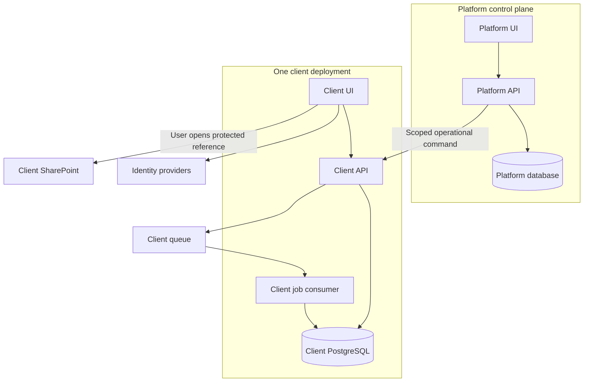
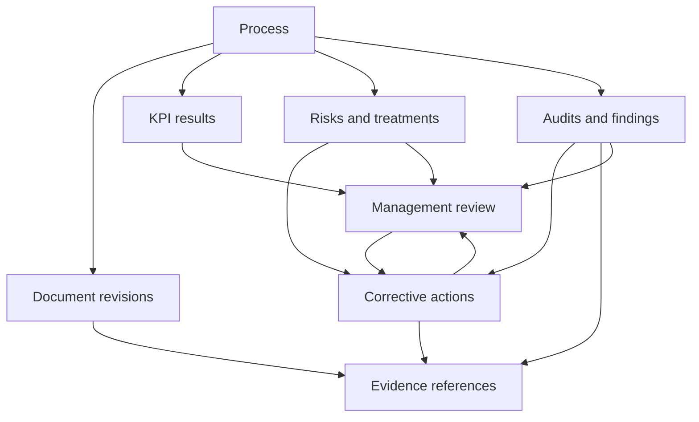

> **SUPERSEDED REFERENCE. Do not implement from this file.** The normative specification is `plan/iQMS-Consolidated-Backend-Plan-v3.md`. Its surviving requirements are merged into v3; nothing here applies on its own.

# iQMS Architecture and Development Specification

Version 1.3 | 14 October 2026 | Product owner: Danica Marie Boton

Revision 1.1 expands this specification into an enterprise engineering baseline: Cloudflare production practices, cybersecurity implementation, policy governance, secure delivery, operational procedures and evidence-based launch gates. Sections 31–45 are mandatory additions to the original architecture. A proposed numerical target remains proposed until approved; no release may claim compliance based on this specification alone.

Purpose: give Codex a coherent, detailed specification for designing and building the production backend behind the existing iQMS interface. This is a development baseline, not a claim that the prototype already implements these controls or that the product has achieved certification.

## 1. How to use this specification

Read the whole specification before choosing infrastructure or writing migrations. Treat MUST as a required product invariant, SHOULD as a recommended implementation, and PROPOSED as a default requiring an architecture decision record (ADR) before production. Resolve critical open decisions in section 25. Preserve the existing UI design while replacing sample behavior with real services. Do not silently weaken security to make a screen work.

The first implementation task is to produce a repository-grounded architecture package: entity relationship diagrams, final SQL schema, OpenAPI contracts, authorization matrix, workflow transition tables, deployment manifest, threat model and test plan. Then implement in the phases below. Do not publish to production, mutate live client data or push changes merely because this document describes future deployment.

## 2. Source baseline and current gaps

Repository: https://github.com/dbauto/afdhlskdfs-iqms-preview

Preview: https://dbauto.github.io/afdhlskdfs-iqms-preview/

Inspected commit: f6129e6, “Process form: ISO 9001 clause multi-select with search”. Reinspect the current default branch when starting development and record its full SHA; later changes take precedence as UI evidence, but do not automatically override this specification's agreed product requirements.

Relevant source files:

- app/src/App.tsx: client, authentication, settings and platform routes.
- app/src/data/types.ts: current prototype record shapes.
- app/src/lib/store.tsx: in-memory collections, simulated identity and ranked UI access levels.
- app/src/pages/documents/detail.tsx: draft/review/approval/publication interactions.
- app/src/pages/audits/detail.tsx: checklist, findings and report interactions.
- app/src/pages/review/management-review.tsx: inputs and decisions held in page state.
- app/src/pages/evidence/evidence.tsx: link/file options, currently conflicting with links-only policy.

The prototype has no demonstrated production identity, durable business persistence or backend authorization. Names serve as relationships; record numbering is generated in the browser; some comments, findings and decisions are local state; dates, summary flags and notifications are partly illustrative. Production MUST remove identity fallback to the first sample user. Unknown or inactive identities receive no access. Production seed scripts MUST NOT insert demo client records.

Current scope includes Overview, Search, Organization & Scope, Policies, Processes, Objectives & KPIs, Documents/Register/Reviews, Risks & Opportunities, Evidence, Audits/checklists/templates, Management Review, Corrective Action, Settings and Platform Admin. Surveys and PDCA visual pipelines are extension points, not confirmed screens in this inspected baseline.

## 3. Product goals and boundaries

Build a configurable ISO 9001 QMS workspace with a standard core and purchased/custom modules. Each client has its own deployment, database, hostname and configuration. One codebase supports all clients; avoid separate repository forks for ordinary customization.

The app manages records, relationships, assignments, review decisions and evidence references. Actual controlled document/evidence files remain in the client's SharePoint/OneDrive or approved document platform. No file-upload endpoint is part of the initial client product. Generated export packages are a separate, temporary output function.

Platform administration and client administration are separate authorities. A developer does not automatically become a client approver. Client Owner is the maximum organization administration role, constrained by confidentiality rules, workflow assignments and separation-of-duty policy.

No ISO certification guarantee, universal legal-signature guarantee, AI decision engine, payment processor, arbitrary scripting engine or enterprise analytics warehouse is included in the first release.

## 4. Decision register

| Decision | Status | Design consequence |
|---|---|---|
| Separate deployment per client | Agreed direction | Separate frontend/API/configuration |
| Separate client database | Agreed direction | Fixed database binding and credentials per deployment |
| Cloudflare account owned by operator initially | Agreed direction | Account-level billing and outage exposure remain shared |
| One shared codebase | Agreed direction | Configurable modules and controlled releases |
| Separate Platform Admin application | Agreed direction | Different hostname, identity policy, API and database |
| Managed PostgreSQL | Recommended baseline | Provider and project topology remain open |
| Microsoft employee sign-in | Agreed direction | Entra tenant validation and invitation-based membership |
| Supabase Auth for email/guest identities | Recommended baseline | Decide direct OIDC versus broker topology |
| Server-managed browser sessions | Recommended baseline | Host-only secure cookies and revocation |
| SharePoint links only initially | Agreed direction | No implicit file permission escalation |
| Background Graph integration | Deferred | Enable only for approved feature and selected resources |
| Expiring client-approved support access | Agreed direction | Enforced in client API; revocable locally |

Separate logical databases can share a managed PostgreSQL server. This is not dedicated compute or independent availability. A separate Supabase project is different from a second schema inside one project; specify exactly which separation is being purchased. Do not promise independent auth isolation from database separation alone.

## 5. Runtime and deployment architecture

PROPOSED stack: existing React/TypeScript frontend; TypeScript Cloudflare Worker API; modular application services; PostgreSQL; Cloudflare Hyperdrive or a verified provider connection; queue consumer Workers and Cron triggers; managed identity; restricted temporary object storage for exports. Select framework, ORM and database driver through ADR after testing transactions in Workers. Suggested candidates are Hono, Zod, Drizzle and Vitest; these are proposals, not hard constraints.

Use a modular monolith, not separate microservices for every QMS module. Keep domain logic portable outside the Worker entrypoint. Cloudflare Queues executes deferred side effects; PostgreSQL stores authoritative business workflow state. Human approvals MUST NOT depend on a running request or an unpersisted queue message.



Every deployment manifest identifies organization ID, environment, hostname, code version, database binding, queue bindings, auth issuer/tenant allowlist, integration secret references, entitlements and approved region configuration. It contains secret references, never secret values. Never accept a caller-supplied database connection string or tenant-selected database name.

Client APIs remain functional during a platform console outage, except operations that genuinely require provisioning or billing changes. Locally validated, bounded entitlements can avoid a platform call on every request. Signed operational commands need audience, client ID, command ID, expiry and replay protection. Sensitive support operations fail closed when authorization cannot be established.

Disable Hyperdrive query caching initially for business and authorization queries; caching is enabled by default in the service. Introduce caching only with explicit consistency tests and an ADR. Do not cache permission-sensitive responses at the CDN as public content.

## 6. Ownership and data locations

| Store | Owns | Must not contain |
|---|---|---|
| Platform DB | Client registry, plan, deployment metadata, health summaries, support request metadata, platform identities | Replicated QMS content or raw integration secrets |
| Client DB | Membership, roles, QMS records, revisions, decisions, tasks, evidence references, privacy operations | Passwords or unencrypted service credentials |
| Identity provider | Credentials, MFA factors, authentication state | Application record authorization decisions |
| Backend secrets | Service credentials and key references | Browser-readable settings |
| SharePoint | Actual document/evidence files and versions | iQMS-only business permissions as a substitute for Microsoft access |
| Export object store | Short-lived generated output | General client file uploads |
| Backup system | Encrypted recovery copies and metadata | Publicly accessible archives |

Names, emails, document titles, comments, findings, links and logs may themselves contain personal data. Include all stores and data transfers in the inventory. Region selection for PostgreSQL does not prove residency for authentication, edge execution, logs, queues, support or backups.

## 7. Authentication architecture

Choose one of these client identity topologies in an ADR; do not run two half-integrated login systems:

1. Direct Entra OIDC for Microsoft users plus Supabase Auth for fallback email/guest users, normalized by the backend identity adapter. This requires two explicit issuer-validation paths.
2. Supabase Auth brokers Microsoft Azure OAuth plus email identities, providing one application issuer. Prove upstream tenant restrictions, identity claims, required assurance and guest behavior. Do not confuse social Microsoft OAuth with enterprise SAML SSO or assume equal features/pricing.

Platform staff use restricted team Entra identity with MFA. If the operator has no team tenant, select a managed privileged identity alternative rather than creating insecure local passwords.

OIDC flow uses authorization code, PKCE, state and nonce with approved exact callback URLs. Validate issuer, audience, signature, expiry and tenant claims as applicable. Identify people by stable issuer/subject; for Entra keep tenant/object identifiers where available. Never merge identities automatically solely because emails match. Account linking requires verified proof of both identities or a controlled recovery procedure.

Microsoft sign-in does not grant membership. Invited identity must match invitation rules, configured tenant policy and active local membership. Personal Microsoft accounts and cross-tenant guests are blocked unless specifically enabled for that client. Supabase Microsoft defaults and supported account types must be checked; its common tenant default is not an organization access policy.

Browser receives an opaque random session token in a __Host- prefixed Secure, HttpOnly, Path=/ cookie without Domain. Store only the token hash, principal, organization, assurance state, expiry, revocation and authorization epoch in the session store. SameSite=Lax is proposed; test redirects and CSRF controls. Rotate on login and privilege changes. Keep provider tokens server-side when needed; encrypt retained refresh tokens with separately managed keys. Do not store bearer tokens in localStorage.

Require CSRF protection and Origin verification for cookie-authenticated mutations. CORS allows only configured origins. Logout revokes the app session; describe separately whether upstream Microsoft sign-out occurs. Password reset, verified email, rate limits and MFA are managed by the provider. Privileged app actions require verified assurance, not merely a visible MFA setting.

PROPOSED defaults: 30-minute idle and 8-hour absolute session expiry; recent step-up authentication for owner transfer, permission escalation, export and support grants. Validate Entra assurance signals rather than assuming an ordinary ID token proves MFA. Final values are client policy decisions.

## 8. Authorization and role model

Authorization is: active membership AND action permission AND entitled module AND permitted scope AND classification access AND valid workflow state/assignment AND no policy conflict. Deny by default. Evaluate on every request, including search, counts, activity feeds, exports, link resolution, background processing and support access.

Use individual permissions, such as document.read, document.create, document.edit_draft, document.submit, document.review, document.approve, document.publish, document.archive, audit.plan, audit.answer, audit.issue_report, corrective_action.verify, user.manage, role.manage, data.export and support.grant. Approval does not imply editing or publication.

Membership can have multiple roles. Role grants include scope: organization, department, location, assigned process or assigned record. A role definition must not imply a staff name relationship. Use membership IDs for business assignments. Templates: Client Owner, Client Administrator, Quality Manager, Process Owner, Contributor, Reviewer/Approver, Auditor, Viewer and Guest Auditor.

| Role/authority | Allowed baseline | Additional restriction |
|---|---|---|
| Platform staff | Provisioning, deployments, health, support requests | No routine client content access or business approval |
| Client Owner | Whole-organization administration and ownership | Confidential records and approvals follow explicit policy |
| Client Administrator | Staff and workspace configuration | Cannot create platform privileges or exceed grant ceiling |
| Quality Manager | QMS coordination and authorized reporting | Required workflow assignments still apply |
| Process Owner | Owned/assigned processes | Other process data requires another grant |
| Reviewer/Approver | Assigned steps | Exact revision and active assignment required |
| Auditor | Assigned audits/evidence | Independence policy can prohibit own-process audit |
| Guest Auditor | Explicit records/scopes until expiry | No general organization browsing by default |

Public classification means least restricted inside the workspace; it does not mean anonymous internet publication. Confidential and Highly confidential use explicit access policy/grants. Define whether Owner has confidential access; do not silently assume it. Sharing may grant permitted record reading within policy, not promote role, bypass classification or grant SharePoint access.

Administration follows grant ceilings: cannot assign permissions outside authorized administrative capability; protect last active Owner; owner transfer is atomic and step-up protected. Record client-approved emergency recovery procedures. User deactivation increments authorization epoch, revokes sessions and creates reassignment tasks while preserving historical attribution.

## 9. Platform versus client administration

Platform database logical tables: clients, client_domains, deployments, releases, entitlements, provisioning_requests, platform_principals, platform_roles, support_requests, operational_commands, health_reports, billing_references, platform_events and migration_runs.

Client DB is authoritative for effective support grants. Grant fields: ID, platform principal, client approver, ticket/purpose, allowed actions, record/process scope, classification ceiling, start/end, revocation and constraints. Every support request checks it locally. Use the developer's real identity with support context; do not silently impersonate staff. Log support session creation, resource access and operations. Default support is read-only, denies confidential records and denies business approvals. Export requires a separate explicit grant.

Initial support expiry proposal: at most 4 hours with renewal by the client. Revocation blocks subsequent requests immediately. A platform-side record alone cannot extend an expired client grant. A platform health page receives sanitized codes and counts, not detailed confidential failures or raw SQL payloads.

## 10. Database conventions and integrity

Use stable UUID primary keys; versioned human codes are separate strings. Tenant business tables carry organization_id even in a single-client database. Enforce that the DB belongs to its configured organization. Use composite foreign keys or equivalent constraints to prevent mismatched organization references. All timestamps use UTC timestamptz; use date for date-only deadlines and an IANA timezone for scheduling. Audit years/reporting periods follow organization settings.

Foreign keys, unique constraints and CHECK constraints enforce invariants. Prefer restrict-on-delete for historical business relationships. Tombstones are not a retention strategy by themselves. Monetary values and quantitative measurements use decimal/numeric rather than floating-point when exactness matters. JSONB supports structured answer payloads and snapshots; core identities, relationships and searchable fields remain typed columns.

Common mutable fields: id, organization_id, created_at, created_by, updated_at, updated_by, row_version. Add status, classification, retention_category_id where appropriate. Actor references account for system jobs and support actors; do not require fictitious human users.

DB runtime role MUST NOT be superuser, schema owner or BYPASSRLS. Migration role is separate. Use PostgreSQL RLS where it provides defense in depth, with transaction-scoped organization/principal context and tested pool reset behavior. Fail if context is missing. RLS is not a replacement for application action/workflow authorization. A table with RLS enabled but a bypassing service key is not isolated.

Important indexes: organization/status/due dates; process relations; record code uniqueness; revision document/number uniqueness; active workflow lookup; session hash; outbox pending/next_attempt; notification deduplication; measurement objective/period; search vectors. Indexes should follow measured query patterns.

## 11. Logical entity catalogue

Codex MUST expand this into final DDL with field types, cardinalities, indexes, constraints and deletion behavior.

| Domain | Tables/entities and minimum information |
|---|---|
| Identity | principals; external_identities (issuer, subject, tenant); memberships (status, expiry); sessions; invitations; access_requests |
| Authorization | roles; permissions; membership_roles; role_permissions; scope_assignments; record_grants; authorization_epoch |
| Organization | organizations; departments; locations; scope_versions; context_issues; interested_parties; interested_party_reviews |
| Processes | processes; process_versions; process_memberships; process_connections (source/target/type); process_clause_links |
| Standards | standards (edition); clauses (parent/code); typed record_clause mappings |
| Policies | policies; policy_revisions; policy_acknowledgements; audience_assignments |
| Documents | documents; document_revisions; external_references; revision_reference_links; document_shares; revision_comments |
| Workflow | workflow_definitions; workflow_definition_versions; workflow_instances; workflow_steps; step_assignments; workflow_decisions; transitions |
| Objectives | objectives; measure_definition_versions; objective_target_versions; measurement_periods; measurement_results; result_corrections |
| Risks | risks_opportunities; risk_assessments; treatment_plans; risk_reviews; linked_actions |
| Evidence | evidence_items; evidence_reference_versions; typed record_evidence links; evidence_clause_links |
| Audits | audit_programmes; audits; audit_processes; auditor_assignments; checklist_templates; template_versions; audit_checklists; sections; questions; answers; findings; audit_report_versions |
| Improvement | nonconformities; containment_records; root_cause_versions; action_tasks; task_assignees; verifications; effectiveness_reviews; closure_decisions |
| Management review | management_reviews; attendees; agenda_items; review_inputs; input_snapshots; decisions; linked_tasks |
| Operations | outbox_events; jobs; job_attempts; processed_messages; notifications; delivery_attempts; idempotency_records; numbering_counters |
| Settings | configuration_versions; numbering_rules; retention_rules; notification_preferences; integration_connections; entitlements |
| Privacy and audit | business_events; access_events; support_grants; data_subject_requests; legal_holds; deletion_jobs; export_jobs; incident_records; evidence_register |

Prefer typed join tables with real foreign keys for cross-module relationships. If using a generic entity registry, design enforced target existence and tenant integrity; a free-text entity_type/entity_id pair is insufficient integrity by itself.

Cardinalities: organization has many memberships/processes; principal has multiple external identities; membership has multiple roles/scopes; process has multiple owners/assignments with designated accountable owner; document has many revisions; revision has workflow instances across resubmission cycles; instance has ordered steps; step has assignments and decisions; audit has multiple processes/clauses/auditors/findings; objective has many period results; evidence has many authorized record links.

## 12. Process-centered relationships and PDCA



PDCA mapping is a reporting/navigation model: Plan = scope, processes, objectives, risks and planned controls; Do = controlled work and evidence; Check = KPI results, audits and management review; Act = treatments, corrective actions and improvement decisions. If adding a process pipeline, keep its board placement separate from document/audit lifecycle states. Moving a card to Act must not close a nonconformity or approve a document. Preserve existing process card design unless separately requested.

## 13. Shared request and event flow

1. Browser submits command with cookie, CSRF proof, expected row_version and idempotency key for consequential/retryable operations.
2. Worker identifies organization from fixed trusted deployment binding and validates hostname/environment.
3. Validate identity, membership, assurance, entitlements, scope, classification, assignment and state.
4. Validate typed input, references and expected version.
5. Begin DB transaction; lock/version-check required records and recheck mutation-sensitive conditions inside transaction.
6. Write business changes, business event and outbox event atomically.
7. Commit; return authoritative result, new version and request ID.
8. Dispatcher reads committed outbox entries, publishes IDs/minimal metadata and records dispatch outcome.
9. Queue consumer loads current job and permissions, performs idempotent side effect and records result.
10. UI invalidates affected query caches and reloads server-derived summaries.

The outbox is the durable bridge between DB commit and queue publish. Crash after publish/before marking dispatched creates a duplicate, so consumer deduplication is mandatory. Queue success does not determine whether a document was published; the committed business record does.

## 14. Document, policy and approval lifecycle

Document stores stable identity/code/process/type. Revision stores revision number, content description, classification at that version, change summary, exact external reference and workflow status. Published and approved revision metadata is immutable except controlled annotations; corrections create a new revision or explicit superseding event.

| Transition | Authority and prerequisites | Atomic writes |
|---|---|---|
| Draft to Technical review | Submit permission; complete required fields; resolvable version strategy; active reviewers | Snapshot workflow version; assignments; submission event |
| Technical review to Approval | Required reviews complete; no unresolved blocking change request | Review decisions retained; approval assignments activated |
| Review/Approval to Changes requested | Assigned actor; mandatory reason | Decision; previous step history; workflow cancellation/return |
| Changes requested to Draft/resubmitted review | Authorized editor; updated revision and explicit resubmission policy | New cycle; no reuse of stale approvals |
| Approval to Ready to publish | All/any/ordered policy satisfied; identity and revision still valid | Final approval outcome; publication task |
| Ready to publish to Published | Publish permission; all checks satisfied; exact approved reference unchanged | Publication event; current-published pointer; supersession |
| Published to Archived | Authorized archive; retention/hold and replacement policy respected | Archive reason and event |

At most one active workflow per revision and at most one active revision workflow per document if preserving the existing block-on-ongoing-approval requirement. Enforce with partial unique constraints and transaction rules. Rejections/changes invalidate the correct cycle; late decisions for superseded assignments fail.

Modes: ALL requires all active configured assignments; ANY completes after one eligible positive decision; SEQUENTIAL activates one ordered stage at a time. Capture configured eligible people and definition version at submission. A later role/config change does not rewrite past approvals; an authorized reassignment records why and revalidates authority. Define conflict handling for concurrent request-changes and final-approve commands with locked workflow state.

Default separation-of-duty proposal: no sole self-approval by the author; client may choose stricter rules. Client Owner cannot bypass workflow by editing status. Approval is separate from Publish, matching current UI. Decision stores actor, effective authority, revision ID, decision, timestamp, reason, authentication context and request ID. Reauthentication may be required by client policy. These records support traceability; legal signature suitability needs use-case review.

Policy revision approval can reuse the workflow service. Acknowledgements reference exact policy revision and assigned audience; compute percentages from eligible audience and valid acknowledgements rather than editable totals.

## 15. External document version and evidence strategy

Links-only storage MUST distinguish ordinary mutable links from exact approved references. external_references includes provider, hostname, URL, optional tenant/site/drive/item/version IDs, version label, captured_at, verified_at, verification_method and integrity metadata where obtainable. Treat signed URLs/access tokens as secrets; avoid persisting transient bearer URLs as normal document links.

Option A, limited initial release: client supplies a durable version-specific reference backed by its document-control procedure; iQMS records who asserted it and displays unverified/verified provenance. Do not label manually supplied metadata as machine-verified.

Option B, stronger integration: scoped Microsoft Graph reads capture exact item/version and controlled access metadata. Establish version preservation/retention and a retrieval strategy; an eTag detects change but is not an immutable content copy or guaranteed version retention.

Select A or B before promising revision-proof approvals. If neither can identify retrievable approved content, block controlled-document publication or explicitly limit the workflow to metadata acknowledgement; never imply the content was verified.

Evidence is a reference to an external file version, external link or internal business record. No initial file upload. One item may support multiple clauses/records but visibility is evaluated per link and evidence classification. Linking from a visible record must not expose a restricted evidence title or URL. Evidence age and adequacy are calculated with explicit assessment rules; “older than 12 months” is not universally invalid.

No automatic backend fetch of arbitrary pasted URLs. For future link checks, enforce host allowlists, HTTPS, safe redirects, private-address blocking, time/size limits and no credential forwarding. SharePoint authorization remains separate; app-only access must not proxy content to a user who lacks entitlement.

## 16. Audit workflow

Plan an audit with programme, scope, processes, clauses, dates, reason, lead, team and auditee. Triggered/follow-up audits link their source risk/finding; ordinary audits need no risk/NC. Enforce independence rules using assignments, not name comparisons.

Instantiate an audit checklist from a template version; copying prevents later template edits from changing prior audits. Questions have answer type, required flag, guidance and clauses. Answers carry typed values, respondent, timestamp, evidence links and edit history. Required questions need valid answers or permitted, justified N/A. Multiple auditor contributions remain attributable.

Lifecycle: Planned -> Checklist ready -> Held -> Findings agreed -> Report issued; Follow-up can be represented as a linked audit or explicit state according to final ADR. Overdue/report late are computed conditions, not alternate lifecycle stages. Report issue requires valid checklist completion, finding disposition, summary/conclusion and lead authority. Preserve a report snapshot/version; changes after issuance require an amendment.

Findings include observation/opportunity/minor NC/major NC, affected process, clauses, facts, evidence, agreement status and owner. NC creation uses a durable link and deduplication so retries do not create two cases. Audits without NCs can issue reports normally. Report consolidation references individual contributions and explicit final editorial decisions.

Audit calendar derives events from planned dates and statuses. Store schedule changes and timezone. Calendar export/integration is deferred until approved; internal calendar view is within audit scope.

## 17. Corrective-action and risk workflow

NC stages follow the inspected UI: Raised -> Contained -> Root cause and action -> Action done -> Verification -> Effectiveness -> Closed. Each transition validates required information and authority. Containment records immediate measures; root cause retains method, conclusion and evidence; actions have accountable owner, helpers, deadline and completion proof. Completion is not verification. Verification and effectiveness are separate decisions with identities, dates, findings and evidence. Failed verification returns to required corrective work; reopening records reason and history. Closure cannot erase the originating finding.

Risks/opportunities retain assessment versions: scale definition, likelihood, impact, calculated score, assessor and date. Treatment/action owner and review schedule link to tasks. Do not overwrite old scores; reporting can compare before/after. Risk acceptance and escalation rules are configurable and versioned. A treatment task is not automatically an NC; create an NC only when the business conditions require one.

## 18. Objectives, KPI results and management review

Measure definition includes unit, frequency, scope, calculation method, aggregation method, target direction (at least/at most/range), data source and required evidence. Target and definition versions have effective dates. Store each result by reporting period, scope, value, numerator/denominator where relevant, source, submitter, acceptance status and correction history. Missing data is not zero.

Initial source is manual result entry with provenance. CSV/Excel import is optional later: stage, validate, preview errors, confirm and commit with deduplication; avoid interpreting spreadsheet formulas as trusted code. Employee-level results require explicitly designed employee-to-department aggregation, privacy scopes and weighted calculations. Do not average percentages blindly. Above/below-target decisions use the target applicable to the period.

Management review stores meeting schedule, chair, secretary, attendees, agenda and input requirements. Inputs reference KPI/audit/risk/NC/prior-action records and a frozen snapshot of the versions considered. “Ready” requires a defined readiness assessment and actor. Store meeting minutes, decisions, rationale, responsible person and due dates; decisions can create shared tasks. Review pack generation uses frozen inputs and authorized audience. Finalized minutes are versioned; historical packs do not silently change when source metrics change.

## 19. Overview, search, tasks and notifications

Overview cards query authoritative records: overdue work, open NCs, assigned review steps and upcoming audits. Counts use the same access filter as the associated list. Never show a restricted count/title/snippet and hide only the detail page. If showing aggregate organization statistics to a restricted audience, require a specific approved aggregation permission and privacy assessment.

Start with PostgreSQL search over permitted metadata. Query filtering precedes pagination/aggregation; apply classification and scopes to search vectors, facets and results. Cache keys include organization, principal or equivalent permission scope, authorization epoch and query. Disable permission-sensitive cache by default.

Use shared tasks for cross-module actions with typed source links. Owning module enforces completion rules. Notification preferences may disable optional reminders, not required security notices. Persist notification recipient, source, deduplication key, state and delivery attempts. Recheck access before dispatch and omit confidential titles from email. Send protected deep links. Quiet hours and timezone are client/user settings. Provider retries can still duplicate external email; record provider idempotency support and practical delivery semantics.

## 20. API contract and errors

Version APIs under /api/v1. Same-origin frontend/API is preferred. Resource endpoints expose authorized representations; domain commands enforce transitions. Avoid generic patch(status) as the only approval interface.

Examples:

```text
GET    /api/v1/me
POST   /api/v1/auth/logout
GET    /api/v1/processes
POST   /api/v1/processes
GET    /api/v1/documents/{id}/revisions
POST   /api/v1/documents/{id}/revisions
POST   /api/v1/revisions/{id}/submit
POST   /api/v1/workflow-steps/{id}/decisions
POST   /api/v1/revisions/{id}/publish
POST   /api/v1/audits/{id}/issue-report
POST   /api/v1/findings/{id}/create-nonconformity
POST   /api/v1/nonconformities/{id}/verify
POST   /api/v1/nonconformities/{id}/close
POST   /api/v1/objectives/{id}/results
POST   /api/v1/exports
POST   /api/v1/support-grants
DELETE /api/v1/support-grants/{id}
```

Final OpenAPI defines request/response schemas, permission requirements, classification behavior, version preconditions, idempotency and error examples. Use cursor pagination with stable ordering, bounded limits and validated filters. Unauthorized object access normally returns a consistent non-enumerating response; return 401 for no valid session, 403 for known forbidden actions where safe, 409 for version/state conflicts, 422 for semantic validation and 429 for throttling. Error envelope includes code, safe message, field errors when applicable and request_id; no SQL, credentials or cross-client detail.

Idempotency table key: organization + actor/context + operation + key; save request hash, lifecycle and result. Same key/different payload is a conflict. Deduplication records and business uniqueness must survive the intended retry window. Approval decision uniqueness is permanent business integrity, independent of short-lived request idempotency.

Use optimistic concurrency via row_version/If-Match. Consequential transitions lock/check relevant rows in a transaction. Concurrent publish, owner transfer and numbering MUST yield one valid outcome. Return conflict with safe refresh instructions; do not silently overwrite another user's changes.

## 21. Background jobs and integrations

Job envelope: event_id, organization_id, job_type, resource_id, schema_version, created_at and correlation_id. Payload contains minimum information. Consumer binding selects the DB; reject a mismatched organization ID. Job types include reminders, exports, outbox dispatch, integration checks, retention processing and health summaries.

Retry transient failures with bounded exponential backoff and jitter. Permanent authorization/validation failures do not retry indefinitely. Persist attempts and sanitized errors. Send exhausted work to a dead-letter queue with controlled replay. Exactly-once external effects are not assumed; combine deduplication, database constraints and provider idempotency where available. Periodic reconciliation catches lost schedules or dispatch gaps.

Initial integrations: identity, email delivery and optional billing status. SharePoint link-opening needs no background application token. Future Graph app-only integration uses client-admin consent, selected-resource permissions and certificate-based client credentials where supported. OAuth client credentials has no user refresh token; certificate rotation replaces its credential lifecycle. Certificate private keys stay in backend secret storage. Delegated OAuth integrations have separate encrypted refresh-token handling. Store health/expiry metadata without exposing tokens.

Webhooks validate provider signature, timestamp and replay rules before creating a durable event; deduplicate event IDs. No webhook alone grants staff membership or approval. Third-party outages must not corrupt QMS state.

## 22. Security, privacy and audit evidence

Use TLS, managed encryption at rest, key rotation, scoped service accounts, dependency scanning, parameterized SQL, safe output encoding, CSP, secure headers, rate limiting and secrets redaction. Limit origin access and protect privileged endpoints. Separate development, staging and production credentials; production data is not copied into routine development. Document access to provider dashboards because infrastructure operators may technically access databases outside app support controls. Support grants restrict the app path; they cannot erase cloud operator powers. Use least privilege, access logs and controlled emergency infrastructure access.

Business events include actor/context, organization, resource/version, event type, server timestamp, request ID, reason and redacted change information. Avoid dumping entire confidential record bodies into general logs. Business event tables are append-only to the runtime role. Add tamper evidence using canonical event hashes and signed periodic checkpoints stored in an independently protected retention location. Hash chains alone cannot prevent a privileged attacker rewriting the entire chain. Record integrity checks and separation of administration.

Maintain different log classes: business history, privileged/content-access events and technical telemetry. Define retention and audience separately. Auditing every read is proposed for support/confidential data and configurable for ordinary records; assess performance and privacy impact.

Philippine compliance baseline: RA 10173/IRR, NPC Circular 2023-06 security requirements, NPC Circular 2022-04 registration assessment, NPC Circular 16-03 breach management, and RA 8792 electronic records/signatures where relevant. This is not a complete industry-specific legal register. A DPO/legal review determines client-specific applicability, lawful bases, retention, reporting and signature requirements. Client normally acts as PIC for its QMS; operator as PIP under instructions and PIC for its own business data; confirm actual contracts and activities.

| Area | Product control | Operational evidence/owner |
|---|---|---|
| Purpose/minimization | Purpose-bound fields and relevant notices | Data inventory, lawful-basis assessment; client PIC/DPO |
| Security | Access checks, isolation, encryption, patching | Test/scan reports, access reviews; engineering/security owner |
| Rights | Verified request tracking and controlled fulfillment | Request register and decisions; client DPO |
| Retention | Category schedules, holds, approved deletion | Schedule, deletion runs, backup expiry; client records owner |
| Accountability | Versioned decisions and restricted history | Integrity checks and sampled records; QMS owner |
| Vendors/transfers | Documented providers and actual locations | Contracts, assessments, subprocessor register; operator/client |
| Incidents | Alerts, preservation and escalation | Timeline, assessment, notification evidence; incident lead/DPO |
| Recovery | Protected backups and verified restoration | Restore reports and continuity exercise; operations |

For notifiable personal-data breaches, NPC rules generally use 72 hours from knowledge/reasonable belief subject to applicable criteria and exceptions; DPO/incident lead determines obligations. Do not hardcode “every incident is reportable” or wait for perfect investigation. Contract rapid processor-to-client escalation; one-hour initial escalation is a proposed operational target, not the statutory deadline. Include annual incident-report assessment in the operating calendar and verify current NPC instructions rather than hardcoding one year's date.

Retain an evidence register: requirement/source/version, applicability, owner, control, test/procedure, evidence reference, last review, next review, exceptions and remediation. Privacy/security compliance and ISO 9001 readiness are separate evaluations. Avoid licensed ISO standard text reproduction unless authorized; use identifiers and permitted summaries.

## 23. Retention, export, incident and recovery procedures

Retention rules define record category, purpose, trigger date, period, disposition and approved authority. No universal retention period is assumed. Legal holds prevent affected deletion. Controlled deletion covers primary records, derived indexes, exports, cached data, integration copies and eventual backup expiry. Minimal audit attribution may be retained/pseudonymized under an approved basis; do not promise universal erasure of legally retained history.

Exports recheck permissions when requested, generated and downloaded. Export jobs record requester, approved scope, classification, manifest, checksum, expiry and outcome. PROPOSED default expiry is 24 hours. Authenticated download is preferred; a standalone signed URL remains usable until expiry unless its serving mechanism checks revocation. Never claim an ordinary object-store signed URL has immediate user revocation. Audit export actions.

Backups use provider-supported schedules and point-in-time recovery where selected. Proposed launch targets: RPO at most 24 hours, RTO at most 8 hours; business approval and measured restore tests are required. Stronger targets require supported paid features and demonstrated procedures. Separate DBs on one host can share backup infrastructure; prove restore-to-one-client without overwriting others. Secure recovery copies with different access and deletion protections.

Restoration: isolate restored instance; verify integrity/version; replay current membership revocations, holds and approved deletions; rotate affected secrets as needed; test; controlled cutover. Recovering old sessions or deleted access must not resurrect privileges. Conduct restore exercises before launch and periodically thereafter. Incident recovery preserves evidence before destructive remediation and records chain of custody where needed.

Client offboarding: verify authority; stop new business processing per contract; provide authorized export; revoke integrations/sessions; apply agreed retention/hold; delete eligible data; allow backups to expire; issue a scoped completion record. Suspension must not accidentally block required legal export or emergency client access; define contract/policy.

## 24. Observability, capacity and release management

Monitor request latency/error rates, database latency/connections, authorization denials, outbox age, queue delay, retries, dead letters, export failures, integration health, backup age, restore verification and migration state. Alert owners and escalation contacts with client-safe identifiers. Telemetry redaction tests are required. Record account-level Cloudflare and database-server shared failure domains.

PROPOSED launch capacity: 50 registered users per initial client; test normal concurrency and a 50-active-user burst separately. Use synthetic representative data, not production PII. Suggested performance objectives: ordinary list/detail p95 under 1 second and command p95 under 2 seconds excluding external login/export. These are test targets, not guarantees. Final workload includes document counts, audit answers, years of results and retention size; agree before procurement. Budget database/auth/email/logs/backups/domains as well as Cloudflare; do not equate $5 Workers subscription with complete hosting cost.

Environments: local, integration/staging, production per client. Infrastructure as code describes resources and bindings. CI builds once, records artifact digest, scans, tests and deploys first to staging then an approved canary client. Each client deployment records code/config/schema versions. Feature flags are server enforced. Migrations use expand/backfill/contract and mixed-version compatibility; no automatic destructive rollback after data writes. Application rollback is allowed only against compatible schema; DB restoration is a planned recovery operation.

## 25. Open decisions and production gates

| ID | Decision | Default/proposal | Required evidence/gate |
|---|---|---|---|
| ADR-01 | PostgreSQL provider/project isolation | Managed PostgreSQL per client | Worker transaction POC; cost; backup/restore proof |
| ADR-02 | Identity topology | Direct Entra plus managed fallback, or broker | Tenant/guest/claim/MFA tests; feature/pricing review |
| ADR-03 | Confidential Owner access | Explicit policy/grants | Product/client approval and negative tests |
| ADR-04 | Approved external version strategy | Durable version reference or scoped Graph | Retrieval and retention demonstration |
| ADR-05 | Workflow independence rules | Block sole self-approval | Client workflow requirements and tests |
| ADR-06 | Regions and subprocessors | Document actual locations | Vendor/contracts/residency assessment |
| ADR-07 | Retention and holds | Per-category client policy | DPO/records-owner review |
| ADR-08 | Recovery/service objectives | RPO 24h/RTO 8h proposed | Restore exercise and commercial agreement |
| ADR-09 | Guest expiry and sharing | Invitation-only, bounded | Client policy and revocation tests |
| ADR-10 | Billing/seat enforcement | Entitlements locally enforced | Define billable users, suspension and emergency access |
| ADR-11 | Survey/KPI import extensions | Deferred modules | Separate schema/API/privacy design |
| ADR-12 | Platform hosting team identity | Restricted Entra if available | Operator account readiness and recovery plan |

Development may proceed on independent modules while these decisions are reviewed; no publication feature should pretend ADR-04 is resolved. Mark blocked features explicitly.

## 26. Development phases and exit criteria

| Phase | Deliverables | Exit criteria |
|---|---|---|
| 0 Architecture validation | Updated repo inventory, ADRs, threat model, final ERD/OpenAPI, provider POCs | Critical identity/isolation/version/recovery paths proven |
| 1 Foundation | Deployable environments, migrations, identity, sessions, membership, roles, scopes, audit/outbox | Unauthorized and cross-client requests fail; revocation works |
| 2 Core document management | Organization/processes/clauses, document revisions, policies, workflows, evidence links | Full review/change/approve/publish history survives reload and concurrency |
| 3 QMS operations | KPIs, risks, audits, checklists, findings, NC/tasks, management review | Real cross-module traceability and valid final reports |
| 4 Platform operations | Provisioning, entitlements, scoped support, jobs, monitoring, exports/retention | Automated second-client setup and local support revocation |
| 5 Production qualification | Capacity/security tests, restore exercise, incident drill, client UAT, operating policies | Signed launch checklist and recorded evidence |

No fixed timeline is asserted before provider selection and gap estimation. Codex should estimate effort by phase and dependency after architecture validation. Document management can be the first client-facing release, with unreleased modules hidden and server-denied.

## 27. Acceptance tests Codex must implement

Use unit tests for domain policy/calculation; integration tests with real PostgreSQL for constraints/transactions/RLS; end-to-end tests for user flows; negative authorization tests for every endpoint. Mocks alone cannot prove tenant isolation or concurrency.

1. Client A cookie/token/ID cannot read or mutate Client B, including search, counts, exports, queue jobs and support commands.
2. Unknown identity gets no sample-user fallback; uninvited Microsoft user has no membership.
3. Wrong Microsoft tenant/personal account and invalid issuer/audience/signature are rejected.
4. Deactivated/expired membership and revoked support grants block subsequent requests and downloads.
5. Contributor cannot approve via API; Approver cannot edit merely because approval exists.
6. Owner cannot create platform privileges or bypass confidential/workflow rules.
7. Concurrent final approvals/publication produce one valid outcome; stale revision decisions fail.
8. ALL/ANY/SEQUENTIAL and change-request/resubmission rules preserve correct decision history.
9. Mutating approved external reference invalidates publication eligibility; version evidence remains retrievable under chosen strategy.
10. Concurrent numbering creates unique human codes; idempotent command retries do not duplicate records.
11. Transaction failure creates neither partial business change nor orphaned success event.
12. Crash between outbox publish and mark-dispatched safely tolerates duplicate delivery.
13. Audit with no NC can issue; missing required answers prevent issuance; amended reports preserve prior versions.
14. NC cannot close before required verification/effectiveness; failed checks return to corrective work.
15. KPI direction, weighted aggregation, period targets, corrections and missing results calculate correctly.
16. Old management-review snapshots remain stable after later source corrections.
17. Sharing/search/evidence links do not leak confidential titles, counts or URLs.
18. Session fixation, CSRF, account linking and recovery flows cannot elevate access.
19. Arbitrary link checking cannot reach private infrastructure or forward credentials.
20. Queue retries/dead-letter replay and webhook deduplication preserve integrity.
21. Legal hold prevents deletion; export expiry/access checks work; backup restoration does not resurrect revoked access.
22. Logs contain no passwords, bearer tokens, raw secrets or unnecessary confidential content; tamper checkpoints verify.
23. Production deployment has no demo seed records and no public service-role credentials.
24. Second client provisioning has different DB credentials/bindings; restore affects only selected client.
25. Load test and restore drill meet explicitly approved targets, with measured reports.

## 28. Repository structure and handoff outputs

Suggested structure, adapting to existing repository conventions:

```text
app/                         existing client frontend
platform/                    separate platform frontend if extracted
services/client-api/         Worker entrypoints and API routes
services/platform-api/       platform-only operations
services/jobs/               queue/cron entrypoints
packages/domain/             policies, workflow rules, calculations
packages/contracts/          schemas and shared API types
packages/database/           migrations, repositories and constraints
packages/authorization/      permission evaluation
infra/                       resource manifests and deployment automation
tests/                       integration, authorization and E2E
architecture/                ADRs, ERDs, OpenAPI and threat model
runbooks/                    recovery, incident, provisioning and release
```

Avoid a generic unrestricted add/update/remove API replacing the prototype store. Refactor frontend calls to typed resource queries and domain commands. Keep localStorage only for non-sensitive UI preferences. All summary cards, comments, notifications and assignment labels load from authorized server data. Show real loading, empty, error, forbidden, conflict and reconnect states.

Required architecture output files: architecture-overview.md; decisions/ADR-*.md; client-schema.sql or reviewed migrations; platform-schema.sql; data-dictionary.md; permissions-matrix.csv; workflow-transitions.md; openapi.yaml; deployment-manifest.schema.json; threat-model.md; compliance-control-register.csv; test-plan.md; development-backlog.md; operating-runbooks.md. These are requested future Codex outputs, not included implementation files in this specification.

## 29. Copyable Codex handoff instruction

```text
Act as the senior backend architect and implementation engineer for iQMS.
Read this entire specification and inspect the current dbauto/afdhlskdfs-iqms-preview repository. Record the current commit and map every current page/action to a persisted entity, API operation, authorization rule and workflow transition. Preserve the established frontend visual design.

First produce the concrete architecture package listed in sections 28 and 40. Apply the enterprise engineering, cybersecurity, policy and launch requirements in sections 31–45, including white labeling, continuous development, customization, client-owned accounts and optional AI. Distinguish agreed requirements, proposed defaults and unresolved ADRs. Validate Cloudflare Worker/PostgreSQL transactions, identity tenant/assurance handling, per-client bindings and approved SharePoint version references through focused proofs of concept. Do not treat prototype sample data, UI button visibility or provider defaults as security controls. Build a control-to-implementation-to-test-to-evidence matrix. Produce actual policy and runbook drafts, not only a list of their titles. Record any unmet launch gates explicitly.

Use a modular backend, separate client deployments/databases, separate Platform Admin authority, backend-enforced action/scope/classification permissions, durable revision-specific workflows, transactional audit/outbox events and idempotent jobs. Follow all integrity, privacy, recovery and acceptance requirements in this document. Avoid arbitrary file uploads, mutable-link-only approval claims, client-selected DB routing, hidden impersonation and unrestricted status patches.

Then implement in the development phases with meaningful integration and negative tests. Explain architectural conflicts and blocked decisions without silently changing requirements. Work in an isolated development branch/worktree. Do not deploy to production, mutate live client data or push to remote without separate authorization. Deliver architecture documents, reviewable code, migration procedures, measured validation and an explicit list of production blockers.
```

## 30. Primary references and verification notes

Sources below were checked for this specification on 14 October 2026. Recheck current documentation before procurement/production, especially identity features, provider limits and NPC reporting instructions. Product controls above are engineering design choices implementing requirements; not every proposed feature is itself a statutory mandate.

- Source repository: https://github.com/dbauto/afdhlskdfs-iqms-preview
- Cloudflare PostgreSQL/Workers: https://developers.cloudflare.com/workers/tutorials/postgres/
- Hyperdrive query caching: https://developers.cloudflare.com/hyperdrive/concepts/query-caching/
- Cloudflare Queues: https://developers.cloudflare.com/queues/
- Supabase Microsoft identity configuration: https://supabase.com/docs/guides/auth/social-login/auth-azure
- Supabase enterprise Azure SSO: https://supabase.com/docs/guides/platform/sso/azure
- RA 10173: https://privacy.gov.ph/data-privacy-act/
- NPC issuances/current circular catalogue: https://privacy.gov.ph/pips-and-pics/advisories-circulars/
- NPC Circular 2023-06: https://privacy.gov.ph/wp-content/uploads/2024/03/NPC-Circular-Repeal-16-01-Signed.pdf
- NPC Circular 2022-04: https://privacy.gov.ph/wp-content/uploads/2023/05/Circular-2022-04-1.pdf
- NPC Circular 16-03: https://privacy.gov.ph/wp-content/uploads/2022/01/sgd-npc-circular-16-03-personal-data-breach-management.pdf
- RA 8792: https://www.bsp.gov.ph/PaymentAndSettlement/RA8792.pdf

The document supports architecture/development planning and audit evidence design. Before launch, the actual client sector, contractual scope and current Philippine requirements must be assessed by the responsible DPO/legal adviser. Compliance depends on implemented controls and operating evidence, not the existence of this document.

## 31. Enterprise engineering standard and applicability

Enterprise is a delivery and operating discipline, not a product-plan name. MUST follow applicable current Cloudflare guidance for the products actually selected, plus the application controls in this specification. Do not enable every Cloudflare service or assume a paid Enterprise plan is mandatory. Determine product availability, quotas, logging retention, account permissions and contractual support/SLA needs before procurement. A feature missing from the selected plan requires a documented equivalent or a launch blocker; never silently omit the control.

Create a standards register with control ID, source URL/version/date checked, applicability rationale, implementation reference, owner, verifier, evidence, review date and exception expiry. Revalidate against current official documentation during architecture validation and major upgrades. Cloudflare guidance is not a complete secure software development framework. Use OWASP ASVS as a proposed application-verification baseline, selecting the current version and applicable requirements in an ADR; target the applicable Level 2 profile initially, with additional high-risk controls. Do not claim conformance until mapped and tested. Privacy/legal applicability remains separately reviewed.

Security is part of each module's definition of done. Architecture decisions include availability, data exposure, operability, migration and vendor failure implications. All exceptions need risk owner, compensating control, justification and expiry; approval does not waive statutory obligations. In a small team, independent review can be an external reviewer; record any unavoidable concentration of duties and compensating checks.

## 32. Cloudflare implementation requirements

| ID | Requirement | Implementation and proof |
|---|---|---|
| CF-01 | Reproducible resource configuration | Version-controlled Wrangler manifests and infrastructure definitions; record reviewed deployment diff and actual bindings |
| CF-02 | Explicit environment isolation | Separate client/environment databases, queues, secrets and export scopes; reject production bindings in local/staging builds |
| CF-03 | Deliberate compatibility management | Pin supported dependencies and compatibility_date; enable only required compatibility flags; test changes before promotion |
| CF-04 | Protected administration | Individual accounts, strong MFA, minimum dashboard roles; documented recovery and privileged-access review |
| CF-05 | Scoped automation credentials | Minimum supported resource/account/zone permissions; inventory token owner, purpose, rotation/revocation; no global API key in CI |
| CF-06 | Secret management | Use backend secrets/bindings; exclude .dev.vars and environment secrets from Git; redact logs; test credential rotation |
| CF-07 | Workers runtime correctness | Runtime integration tests; no reliance on process memory for durable state, arbitrary filesystem persistence or a permanent DB connection |
| CF-08 | Bound resource consumption | Bounded query/payload/page sizes, timeouts, export batching/streaming, concurrency limits and overload tests |
| CF-09 | Durable background execution | Queues/cron and transactional outbox; do not use waitUntil as the sole guarantee for approvals, exports or mandatory notifications |
| CF-10 | Safe database connection/caching | Tested transaction driver and pooling; explicit cache-disabled baseline; verify authorization context does not leak between requests |
| CF-11 | Route and preview protection | Inventory custom domains, routes, workers.dev and preview URLs; disable unused access paths or apply equivalent controls |
| CF-12 | Observability with privacy | Structured logs, version/environment/request IDs, safe redaction and retention; verify actual log collection and alert routing |
| CF-13 | Version-controlled release | Build once; preview/staging tests; reviewed production promotion; gradual rollout where suitable; correlate telemetry to version |
| CF-14 | Mixed-version safety | Backward-compatible DB/event/API changes; test old/new workers together, including service bindings and job consumers |
| CF-15 | Account-level failure planning | Monitor shared quotas and costs; account compromise/provider outage runbooks; clear client communication |
| CF-16 | Administrative edge protection | Assess Cloudflare Access for platform/staging; validate Access tokens where used; app authorization remains mandatory |

Check environment inheritance and non-inheritable binding/secret behavior against current Wrangler documentation; generate explicit manifests instead of trusting inherited defaults. Remote development bindings MUST use disposable/staging resources and synthetic data. Preview endpoints are not safe merely because their URLs are obscure.

Cloudflare Access, WAF rules, rate limiting and DDoS protections supplement backend controls. Availability differs by product/plan; define actual coverage. Protect authentication, invitation, recovery, export and webhook endpoints with suitable controls and tests. A protected custom domain does not protect an alternate workers.dev route automatically. Scope API tokens as narrowly as current APIs permit; when one deployment token can modify all client Workers, explicitly record that shared blast radius and restrict who can use it.

CPU/request limits and stream handling must be tested for the selected Workers plan. Move long-running computation or report generation to a compatible worker/service if it exceeds limits; do not assume all Node packages run unchanged on Workers. Client QMS files remain external even if temporary exports use R2.

## 33. Threat model and cybersecurity design

Before implementation, create a data-flow threat model covering browser, identity providers, client Worker, database/Hyperdrive, queues, exports, SharePoint, platform API, CI runner, operator devices and vendor dashboards. Identify trust boundaries and classify assets: credentials, client records, confidential metadata, approval evidence, backups, deployment authority and audit integrity. Model malicious outsiders, compromised staff/guests, compromised developers, accidental configuration errors and supplier compromise.

| Threat | Required mitigation | Verification |
|---|---|---|
| Cross-client object access | Fixed bindings, local organization checks, constraints and permission filters | Swap IDs/tokens/hosts across every data channel |
| Account takeover | Managed identity, MFA/assurance, rate limits, secure recovery | Tenant/issuer/claim/recovery and session abuse tests |
| Privilege escalation | Action permissions, grant ceilings, classification and step assignment | Direct API misuse and role-edit negative tests |
| Cloud/CI compromise | Narrow permissions, protected releases, secret controls, reviews | Token-scope inspection and credential-revocation exercise |
| Approval tampering | Immutable revision evidence, transactional transitions, integrity checkpoints | Concurrent actions and history-integrity tests |
| Injection and stored XSS | Parameterized queries, schema validation, safe rendering, sanitization where needed | Malicious field/comment/link payloads |
| CSRF/session abuse | Host-only cookies, CSRF and origin checks, rotation | Cross-origin mutation and fixation tests |
| SSRF/file disclosure | No arbitrary server fetch; approved providers and restricted redirects | Private-address, redirect and credential-forwarding tests |
| Queue/webhook forgery | Trusted bindings, signature/replay verification, deduplication | Invalid signatures, duplicates and mismatched clients |
| Export/backups exposure | Scope checks, encryption, bounded expiry, protected recovery access | Revocation/download/restore tests |
| Availability abuse | Input bounds, throttling, queue backpressure, workload limits | Burst and failure-injection tests |
| Insider content access | Minimal infrastructure access, support grants, access events, review | Support expiry and provider-dashboard access review |

Security design includes CSP appropriate to the frontend, HTTPS/HSTS after hostname validation, clickjacking protection, restrictive browser permissions, safe content-type handling and no secret-bearing referrers. Define allowed redirect targets; block open redirects. Sanitize any rich HTML with a vetted library or use plain text. URLs must use approved schemes; do not render javascript/data links from user inputs. Use secure randomness for session/invitation tokens, store hashes and enforce expiry/single use.

No credentials in analytics, error trackers, source maps, URLs or support screenshots. Production source maps are controlled according to disclosure policy. Classify telemetry providers as subprocessors where applicable. Malware scanning is not a substitute for a no-upload policy; enabling future uploads triggers a separate security and retention design.

## 34. Secure development lifecycle and release controls

Required workflow: requirements and threat analysis -> design review -> implementation -> peer review -> automated checks -> staging/UAT -> security qualification -> approved release -> monitoring and maintenance.

Protected main/release branches require recorded reviews and passing required checks. Restrict branch-rule bypass and deployment environment access. Lock dependencies with reviewed update procedures; pin CI actions to immutable revisions where practical. Pipeline must include type checking, linting, domain tests, actual database/Worker integration tests, negative authorization tests, dependency vulnerability scanning, secret scanning and static analysis. Run dynamic security scans against an authorized staging target. Track findings with severity, owner, due date and retest evidence.

Use a reproducible build, dependency inventory/SBOM, artifact checksum and deployment provenance. Trusted CI performs production deployment. Changes to auth, grants, migrations, logs, support access and security configuration require explicit security review. Third-party packages/plugins require provenance, license and maintenance review. Never expose production secrets to untrusted fork pull requests. Limit CI permissions and secret access; deployment authority is isolated from routine test jobs.

Maintain a release record: commit/artifact, dependency inventory, schema/config versions, tests/scans, approvals, targeted clients, rollout schedule, rollback compatibility, monitoring window and outcome. Database migrations require validation on representative data volume and backup/recovery readiness. Hotfixes use a documented expedited procedure with equivalent critical checks and retrospective review.

Proposed vulnerability response targets, subject to staffing/client contracts: active exploitation or exposed production credentials triggers immediate incident response; critical findings triaged within 24 hours and mitigated within 72 hours; high findings within 7 days; medium within 30 days; low within 90 days. These are internal proposed targets, not legal deadlines or promises. Unsupported dependencies and deferred fixes require risk approval and expiry. Public vulnerability intake needs a contact and responsible disclosure procedure; do not authorize arbitrary third-party testing of live client systems.

## 35. Policy package and governance

Codex MUST produce editable policy drafts and matching procedures as part of architecture delivery. Operator management and affected clients approve their policies before production use. Drafts are not signed/adopted policies. The app's client QMS policies and the operator's information-security policies have different owners and audiences.

| Policy ID | Policy | Minimum decisions and procedures | Accountable owner |
|---|---|---|---|
| POL-01 | Information Security | Objectives, risk acceptance, responsibilities, security review and training | Operator management |
| POL-02 | Privacy/Data Protection | PIC/PIP roles, purposes, notices, rights, transfers and DPO escalation | Relevant PIC/DPO |
| POL-03 | Access Control | Role/scopes/classification, joiner/mover/leaver, grant ceilings and review | Client Owner/operator security |
| POL-04 | Authentication/Recovery | MFA, assurance, sessions, account linking, recovery and last-owner safeguards | Identity/security owner |
| POL-05 | Production/Support Access | Client grant, infrastructure access, emergency procedure and review | Operations and client approver |
| POL-06 | Secure Development/Change | Reviews, pipelines, migrations, releases and emergency fixes | Engineering lead |
| POL-07 | Vulnerability Management | Scanning, severity, remediation targets, exceptions and retest | Security owner |
| POL-08 | Logging/Monitoring | Event classes, privacy, alerts, integrity, access and retention | Operations/DPO |
| POL-09 | Incident/Breach Response | Severity, contacts, evidence, escalation and notification assessment | Incident lead/DPO |
| POL-10 | Backup/Continuity | Recovery targets, backup separation, restore tests and provider failure | Operations |
| POL-11 | Retention/Disposal | Category schedules, holds, exports, backup expiry and deletion verification | Client records owner/DPO |
| POL-12 | Vendor/Cloud Management | Due diligence, subprocessors, access, location and exit strategy | Operator management |
| POL-13 | Document Control/Approval | Revision identity, assignments, independence, publication and amendments | Client QMS owner |
| POL-14 | Acceptable Use/Device Security | Managed access, device encryption/patching, credentials and reporting | Operator management |
| POL-15 | Cryptography/Secret Management | Key ownership, storage, rotation, expiry, recovery and compromise | Security/operations |

Every policy has ID/version, scope, owner, approving authority, effective date, review date, requirements, enforcement responsibilities, exceptions and linked procedures/evidence. Proposed review is annually and after material changes/incidents. Never default all client processing to consent; assess lawful basis by purpose/data type.

Contract package: service agreement, data-processing terms, confidentiality, authorized subprocessors, security responsibilities, support authorization, incident escalation, retention/exit, service objectives and audit cooperation. Qualified legal/DPO review is a production gate. Document client obligations for SharePoint access/version preservation and account administration. Do not claim universal audit rights against vendors unless the contract provides them.

## 36. Required operating runbooks

Each runbook specifies triggers, prerequisites, responsible roles, authorized actions, validation, evidence, escalation and completion criteria. Include safe commands or dashboard instructions after infrastructure is chosen; do not ship placeholder steps as a verified procedure.

1. Client provisioning: create isolated resources, verify bindings, establish owner, run negative tests, activate.
2. Joiner/mover/leaver: invite/assign, verify identity, review least privilege, revoke/reassign and preserve history.
3. Privileged access: request, authorize, time bound, monitor, terminate and review; separate infrastructure emergency access from client-app support.
4. Release/migration: prechecks, artifact verification, backup readiness, canary, mixed-version checks, rollout and rollback decision.
5. Secret/certificate rotation: inventory dependencies, stage replacement, verify, revoke old credential, record outcome.
6. Incident response: detect, triage, preserve evidence, contain, inform appropriate client/DPO, assess notification, recover and review.
7. Account takeover: revoke sessions/tokens, disable compromised access, review grants/actions, verified recovery and reassignment.
8. Leaked deployment/cloud credential: revoke credential, freeze deployments as appropriate, review account/resource changes, rotate affected secrets and validate clients.
9. Data exposure/cross-client incident: contain offending path, preserve affected access evidence, determine scope without broad unnecessary exports, engage DPO and notify as required.
10. Backup restoration: select client/time, isolate, verify, reconcile revocations/deletions, approve cutover and record measured RPO/RTO.
11. Queue/provider outage: pause unsafe work, inspect backlog/dead letters, preserve IDs, retry/reconcile and prevent duplicate effects.
12. Rights/retention/offboarding: verify authority, apply holds, scoped export/delete, track provider/backups and issue appropriate record.
13. Security alert handling: ownership, on-call coverage, severity, acknowledgement, escalation and false-positive tuning.
14. Cloud account/provider outage: alternative access and communications, assess recoverability outside shared account, restore procedures and contract commitments.

Runbooks must be exercised with synthetic scenarios before launch. The operator needs named people and realistic coverage; automated alerts without a responder do not establish incident readiness.

## 37. Control, test and evidence matrix

Build security-controls.csv with: control_id, source, applicability, risk, requirement, implementation_path, responsible_owner, verifier, test_id, evidence_location, last_verified, next_review, status, exception_id. Evidence is access controlled and retained under an approved schedule. Link code/configuration to the version tested.

| Control | Implementation | Required verification | Retained evidence |
|---|---|---|---|
| SEC-01 Client isolation | Fixed bindings and DB restrictions | Two-client negative integration/E2E suite | Results, config review, tested versions |
| SEC-02 Privileged identity | MFA/assurance and grant ceilings | Privilege/recovery abuse tests | Identity settings and test report |
| SEC-03 Revision approval | Version references and locked transitions | Concurrent/resubmitted/version-change tests | Decision history and test trace |
| SEC-04 Support authorization | Local scoped grants and real staff identity | Expiry/revocation/export-negative tests | Grant and support-access events |
| SEC-05 Secrets | Secret bindings and restricted CI | Scan plus rotation exercise | Inventory, scan and rotation report |
| SEC-06 Release security | Protected pipeline and provenance | Bypass/fork-secret checks | Build manifest and release record |
| SEC-07 Log integrity/privacy | Redaction, append-only events, external checkpoints | Payload redaction and checkpoint validation | Integrity/redaction report |
| SEC-08 Recovery | Protected backups and runbook | Selected-client restore exercise | Measured restoration report |
| SEC-09 Incident readiness | Contacts, detection and playbooks | Tabletop/credential-compromise exercise | Timeline and improvement actions |
| SEC-10 Vendor/legal scope | Data map, contracts and policy review | Accountable review of actual providers | Approved assessments and register |
| SEC-11 Session/revocation | Secure cookies, epochs and CSRF | Session fixation/cross-origin/revocation tests | Security test report |
| SEC-12 Export/retention | Scoped jobs, holds, authenticated download | Revoke/expire/hold/deletion tests | Export and disposition records |

Maintain a separate client-facing assurance summary with reviewed claims and exceptions. Do not expose confidential architecture/credentials or declare compliance from a green UI indicator. Technical telemetry, business events and compliance evidence have separate retention/access policies.

## 38. Security qualification and launch gates

Launch requires recorded completion or explicitly approved, permissible exceptions. Product owner approves business readiness; engineering/security reviewers validate technical evidence; responsible DPO/legal reviewers assess legal/privacy applicability. No single review substitutes for the others.

| Gate | Required outcome |
|---|---|
| G-01 Architecture | Final ADRs, trust-boundary data flow, schema/API/permission/transition package reviewed |
| G-02 Infrastructure | Binding/route inventory, scoped credentials, admin MFA and staging/production separation verified |
| G-03 Identity | Tenant, guest, account recovery, MFA assurance and session revocation tested |
| G-04 Application security | Applicable security profile mapped; negative tests pass; independent authorized security assessment completed to agreed scope |
| G-05 Findings | No unresolved critical or high exploitable findings; lower findings have owners/targets and reviewed risk |
| G-06 Integrity | Approval/version/concurrency, audit reporting and outbox/job failure cases pass |
| G-07 Data protection | Applicable notices, contracts, retention/holds, vendor assessment and rights procedure approved |
| G-08 Recovery | Successful isolated restoration meets approved objectives and does not resurrect access |
| G-09 Operations | Alerts reach responders; incident/tabletop exercise and production runbooks completed |
| G-10 Client acceptance | Workflow/role UAT, owner onboarding and document-version responsibilities agreed |
| G-11 Performance | Measured realistic load test and capacity/cost headroom accepted |
| G-12 Release | Artifact/schema/config traceability, monitored rollout and compatible rollback plan approved |

Independent assessment may be a qualified external review with a clearly bounded scope; an automated scanner alone is not equivalent to a penetration test. Fixes are retested. Document exclusions and residual risks. Reassess after major auth/isolation changes and on an approved schedule, not just once before initial release.

## 39. Maintenance and review schedule

PROPOSED baseline: continuous dependency/secret checks in CI; daily automated health/backup checks; monthly patch and privileged-access review; quarterly role/support/vendor-access and recovery exercises; annual policy/risk/independent security review, plus material-change triggers. Adjust frequency to actual risk and contractual requirements. Annual statutory reporting follows current NPC requirements separately.

Track configuration drift, expiring certificates/tokens, unsupported runtime dependencies, billing/usage anomalies and log-retention gaps. Security updates roll out through tested releases; clients cannot indefinitely freeze a vulnerable version without approved isolation/mitigation. Document who communicates changes and emergency service restrictions. Maintain a vulnerability backlog, operational evidence and current ownership/contact register.

## 40. Expanded Codex deliverables and official guidance

In addition to section 28, produce:

- enterprise-standards-register.csv with applicable Cloudflare guidance and chosen application verification profile.
- security-architecture.md with assets, trust boundaries, threat model, abuse cases and mitigations.
- cloudflare-security-baseline.md with actual product/plan settings, roles, routes, bindings, secrets and verification steps.
- security-controls.csv linking requirements to implementation, tests, owners and evidence.
- policies/POL-01 through POL-15 editable drafts, with client/operator distinctions and adoption status.
- runbooks for section 36, populated against selected infrastructure and exercised before production.
- secure-delivery.md with branch protection, CI permissions, artifact provenance, scans and release approval.
- vulnerability-management.md with severity, response targets, intake, exceptions and retest.
- security-test-plan.md and results, including authorized independent assessment scope.
- launch-readiness.md listing every gate, evidence, approver, exception and blocker.
- service-responsibility-matrix.md covering operator, client and providers; do not assign responsibilities to an unavailable team.
- incident-contact-register template and maintenance-review schedule.

Use current primary sources; confirm details during implementation. Official Cloudflare references checked for this update on 14 October 2026:

- Workers production best practices: https://developers.cloudflare.com/workers/best-practices/workers-best-practices/
- Wrangler environments: https://developers.cloudflare.com/workers/wrangler/environments/
- Local development and remote bindings: https://developers.cloudflare.com/workers/local-development/
- Worker roles/permissions: https://developers.cloudflare.com/workers/authorization/workers/
- API token permissions: https://developers.cloudflare.com/fundamentals/api/reference/permissions/
- Versions/deployments: https://developers.cloudflare.com/workers/versions-and-deployments/
- Gradual deployment: https://developers.cloudflare.com/workers/versions-and-deployments/gradual-deployments/
- Environment variables: https://developers.cloudflare.com/workers/configuration/environment-variables/

Verify current ASVS source/version, Cloudflare Access/WAF coverage, runtime testing guidance, Secrets Store versus Worker secrets and log retention at architecture validation. Product choice and subscription details are unresolved until verified; this document does not assert all optional services are available on the chosen plan.

## 41. Continuous development and customization lifecycle

Version 1.2 addition, 14 October 2026: continuous delivery, client-owned accounts, versioned customization and optional AI integration. This section and sections 42–44 extend the architecture; provider participation and AI deployment topology remain explicit ADRs.

Maintain one product core with a supported extension contract. Classify requests before implementation:

| Change class | Examples | Delivery model |
|---|---|---|
| Configuration | Branding, departments, roles, numbering, reminders | Validated versioned client settings |
| Declarative customization | Custom fields, forms, approval rules, reports | Schema-versioned definitions with server validation |
| Reusable optional module | Sector-specific audit or supplier evaluation | Reviewed product module, entitlement and feature flag |
| Bespoke integration | Client ERP/CRM/reporting connection | Isolated versioned adapter and scoped service identity |
| Core change | New shared capability or security behavior | Standard product release with compatibility tests |

Avoid unrestricted client JavaScript/SQL or code uploaded through settings. Arbitrary executable extensions require a separate sandbox/security design. Do not maintain an unmanaged repository fork for each client. A truly separate contracted product is an explicit commercial/maintenance decision.

Customization metadata includes ID, client, type, schema_version, configuration_version, compatible_core_versions, module_version, author, approval, effective date and migration history. Use typed fields, validation, classification, reporting/search rules and permission behavior. A custom field must not silently bypass privacy, export or retention controls. Custom reports use an authorized query layer, not arbitrary SQL. Workflow definition edits create new versions; active workflows retain their submitted definition unless explicitly migrated with history.

Changes follow request -> impact/security/data assessment -> estimate -> approved specification -> isolated development -> preview -> client UAT -> migration/release -> monitoring. Keep acceptance criteria, rollback strategy and support owner. Client approval is a product change authorization, never automatic production-code execution.

Maintain a compatibility manifest per deployment: core/API/schema/config/module/adapter versions and release channel. Support stable and pilot channels; propose a bounded current/previous release window, finalized commercially. Security fixes apply to supported versions; clients cannot retain vulnerable releases indefinitely without approved mitigation. Test customization combinations, contract compatibility and representative migrations. Record which clients use each module/config version before rolling out changes.

Core, configuration and extension updates have separate release records. Progressive delivery may start with an internal staging tenant and consenting pilot client. Feature flags have owner, expiry and removal plan. Rollback must preserve schema compatibility and in-flight workflow meaning. A requested customization does not give the client authority over platform secrets, deployment permissions or other clients.

## 42. Client-owned cloud and service accounts

Support both operator-managed and client-owned deployment packages. Client-owned means separate Cloudflare account, database/auth project and optional email/observability accounts as agreed, with billing and ownership explicitly assigned. Do not assume a client's cloud ownership means every staff member receives infrastructure permissions.

Use scoped delegated operator access or a narrowly scoped client-owned automation token; never request the client's password or global API key. Each account has its own production pipeline environment and secret references. Deployment manifests map client to account IDs/resources without storing secret values. Test wrong-account/binding rejection before deployment. Separate platform registry remains operator-owned and stores minimum operational metadata under contract.

Define access duration, emergency support, billing responsibility, provider subscriptions, backup ownership, incident duties, domain/DNS ownership, certificate management and offboarding. Client revocation of operator access may prevent updates/monitoring; document detection and service implications. Provisioning and migrations must work without permanently granting operator account super-administrator.

Provide reproducible infrastructure definitions, deployment inventory, versioned release artifacts and operational documentation. Contract distinguishes client data ownership, source-code licensing and custom-module intellectual property; cloud account ownership alone does not settle source ownership. Supply a documented transfer/exit procedure and credential rotation after transfer.

## 43. Optional AI integration and subscription strategy

AI is optional and disabled by default per client. iQMS authentication and authorization remain independent of AI-provider login. QMS records are the authoritative business state; provider conversations/memory are optional user context and must never establish access, approval authority or audit truth.

Support three potential modes through a provider adapter boundary:

1. Connected assistant: user works in an approved ChatGPT/Claude workspace connected to iQMS through authenticated tools/MCP. This supports provider-native conversational experience where available. Validate connector availability, client workspace policy and usage terms before offering it.
2. Approved subscription-funded embedded integration: eligible provider route lets a user authorize their own plan for an integrated application. This is conditional on commercial participation/approval and supported capabilities, not assumed public access.
3. Managed API integration: client-owned provider billing/credential or explicitly contracted operator billing, with usage caps. Optional fallback only with explicit client authorization; never silently charge API usage when subscription limits are reached.

Verified 14 October 2026: OpenAI describes plan usage in participating commercial apps via Sign in with ChatGPT, with limited partner participation and an interest process. Eligible plans/limits apply. The connection does not itself provide access to prior conversations/memories. Therefore mark embedded subscription support as blocked pending approval, technical documentation and proof of eligibility.

Verified 14 October 2026: Claude help describes subscription-supported Agent SDK/third-party usage and Max/Team API-credit updates, but Agent SDK developer documentation separately restricts offering claude.ai login/rate limits in third-party products without prior approval. These must be reconciled with provider confirmation for this commercial product. Do not treat personal CLI authentication as authorization to resell pooled subscription capacity. No scraping, copied browser cookies or password collection as an integration mechanism.

Prefer initial read-only assistance: explain an authorized process, summarize visible overdue work, draft audit questions or draft a corrective-action description. Require citations to authorized record IDs/revisions. AI output is a draft; authorized humans perform review/approval/publication through normal commands. Initial AI has no autonomous publish, close-NC, grant-access, export-all or delete capability.

Tool layer reuses the same domain services and authorization checks as UI/API. Each tool call has client, authenticated actor, scope, purpose and correlation ID. Read results are filtered before sending to the model. For later write tools, use preview/confirmation, least privilege, idempotency and full business history. Treat documents, tool results and prompts as untrusted input; prevent prompt injection from expanding tool scope or exfiltrating data. No arbitrary SQL, shell or unrestricted HTTP tools in the client assistant.

AI configuration includes client opt-in, allowed provider/region/plan, approved purposes, classifications permitted, data-processing terms, retention/training settings, user permissions, budget/rate caps and kill switch. Reject unavailable or non-compliant provider paths. Client can disable AI while all core workflows remain usable. Bound concurrency and gracefully report quota exhaustion; preserve normal QMS availability.

Provider-native memory, resumable sessions and project context are different capabilities. They do not automatically become accessible inside iQMS. Use approved SDK session persistence where available rather than building a proprietary general memory system for the first release. Persist only required session identifiers, user consent, task/draft provenance and permitted context references, with tenant/user isolation and deletion rules. Provider session storage location, retention and recovery must be documented. Do not claim that using a subscription eliminates session persistence responsibilities.

For API mode, retrieve current authorized QMS records as task context and use supported managed conversation/session features where available. This can avoid a custom long-term memory engine. Remembering authoritative organization settings is accomplished by normal database queries, not model recall. Any provider-managed context remains subject to classification, scope, residency, retention and cost review.

Cloudflare Workers host the API/tool gateway. Do not assume a Claude Code binary/Agent SDK subprocess runs inside Workers; if that runtime is selected, validate a separate compatible hosted or client-controlled execution environment and its authentication/security model. Remote MCP gateway design also requires OAuth audience validation, user consent, scope enforcement, token protection and revocation testing.

## 44. Additional decisions, tests and delivery requirements

Add ADRs for extension metadata/storage, supported release window, client-owned account access, AI modes, provider commercial eligibility, AI session/context behavior and runtime placement. Proposed extension entities: customization_definitions, customization_versions, module_installations, release_channels, compatibility_records and customization_change_requests. Optional AI entities: ai_connections, ai_user_authorizations, ai_sessions, ai_runs, ai_tool_events and draft_provenance. These store metadata and necessary protected references; avoid unnecessary raw prompt/response logging.

Add tests: core upgrade preserves client fields/workflows; custom reports obey scopes; incompatible extension blocks deployment; pilot rollout does not update other clients; wrong-account deployment fails; operator-access revocation is detected; AI cannot see restricted records or execute unauthorized tools; injected document instructions do not expand authority; disconnected/limited AI leaves core usable; no automatic paid fallback; sessions never cross user/client boundaries; AI-produced draft cannot masquerade as a human approval.

Required Codex outputs now also include customization-contract.md, release-compatibility-policy.md, client-owned-deployment-runbook.md, ai-integration-options.md, ai-threat-model.md and an AI eligibility/approval register. Distinguish functionality that is implemented, conditionally feasible and blocked by provider participation. Do not advertise an embedded subscription feature until verified.

Additional primary references checked 14 October 2026:

- https://help.openai.com/en/articles/20001542-using-your-chatgpt-plan-in-other-apps-and-sites
- https://support.claude.com/en/articles/15036540-use-the-claude-agent-sdk-with-your-claude-plan
- https://code.claude.com/docs/en/agent-sdk/overview

Recheck these rapidly changing provider conditions before committing the commercial design.

## 45. Client white labeling and branding

Version 1.3 addition: each client can configure its account/workspace logo and brand colors without a code fork. This is client configuration, isolated by deployment and organization. Initial required scope is workspace/account logo and color theme. Product name, favicon, custom domain, branded emails and export headers are optional entitlements, not assumed commitments; define their scope before delivery.

Client Owner or an explicitly delegated branding.manage role can edit branding within the organization. Platform staff maintain theme capabilities and defaults; client changes cannot affect other clients or platform administration. In a client-owned cloud account the same application role rules apply; cloud ownership does not authorize every employee to change branding.

Create branding_profiles and branding_versions, containing organization_id, schema_version, active_version_id, logo_asset_id, accessible organization name/alt text, approved color tokens, optional dark-theme tokens, actor, timestamp and publication history. Asset metadata includes immutable ID, storage location, digest, media type, dimensions, size, creator and deletion/reference status. Only the published branding version is used by normal users. Draft preview is private to authorized editors. Supply an accessible fallback using organization initials/name when the asset fails.

Theme tokens are semantic: brand primary, on-primary text, navigation/accent and selected/focus variants. Generate or validate contrast-safe derived states. Keep success/warning/error meanings recognizable and separate from brand color; labels/icons must also communicate status. Validate text, control and focus contrast against the selected WCAG accessibility target; propose WCAG 2.2 AA and verify applicable criteria before claiming conformity. Invalid combinations show actionable feedback and cannot be published. Support light theme first and dark theme only if included in product scope; never apply untested inverted colors automatically.

Expose validated theme variables through the existing design system. Do not accept arbitrary CSS, HTML, JavaScript, external fonts or executable templates through branding settings. Test forms, tables, sidebar, dialogs, charts, disabled/hover/focus states and print/export variants where branded outputs are enabled. Provider-owned Microsoft/ChatGPT/Claude sign-in screens may retain provider branding and are outside ordinary iQMS theme control.

Settings flow: Branding -> choose an approved logo asset and colors -> preview representative pages -> validate -> publish -> audit event. Allow reset to product defaults and rollback to an earlier branding version. Use configuration-version checks to avoid overwriting another editor. Cache keys include organization and branding version; publishing invalidates relevant client caches without clearing another client's settings. Branding versions remain compatible with core upgrades through token-schema migrations and regression tests.

Logo ingestion is a narrowly scoped exception to the initial no-document-upload rule. Controlled documents and evidence remain links-only. If enabling client logo uploads, provide a dedicated branding asset endpoint with authorization, CSRF protection, strict size/dimension limits, byte-based type checks, safe decoding and server-side re-encoding into PNG/WebP. Reject active SVG/HTML and misleading file types initially. Strip metadata, use generated object keys and never trust the original filename as a path. Limit stored variants and remove unreferenced assets under retention rules. If image processing is not supported in the selected Worker runtime, use a verified image service or controlled provisioning workflow; do not pretend unsafe uploads are processed. An alternative initial delivery is operator-provisioned approved assets with client-selectable colors.

Brand assets use dedicated storage/prefix and scoped credentials, separate from temporary exports. Treat display logos as publicly retrievable only with explicit client acceptance; never put confidential files in this asset path. URL-based imports must follow SSRF protections or be excluded. CDN responses use correct image content types and safe immutable caching. Product privacy/security disclosures and legal notices must remain available regardless of branding; white labeling cannot conceal required provider/subprocessor information.

Acceptance tests: unauthorized branding edits fail; Client A cannot change/read private draft assets of Client B; invalid color combinations cannot publish; image type/size/polyglot payloads are rejected or safely re-encoded; stored assets cannot execute script; reset/rollback and concurrent edits behave correctly; all enabled UI themes remain readable; new core releases retain client branding; changed logos propagate without stale cross-client caches. Optional custom domains need ownership verification, TLS and cookie/callback configuration from the normal deployment runbook.

Add white-labeling-design.md, theme-token-schema.json, branding permission/API definitions and branding security/regression tests to the Codex deliverables. Record whether client self-service logo upload or controlled asset provisioning is selected before implementation.

